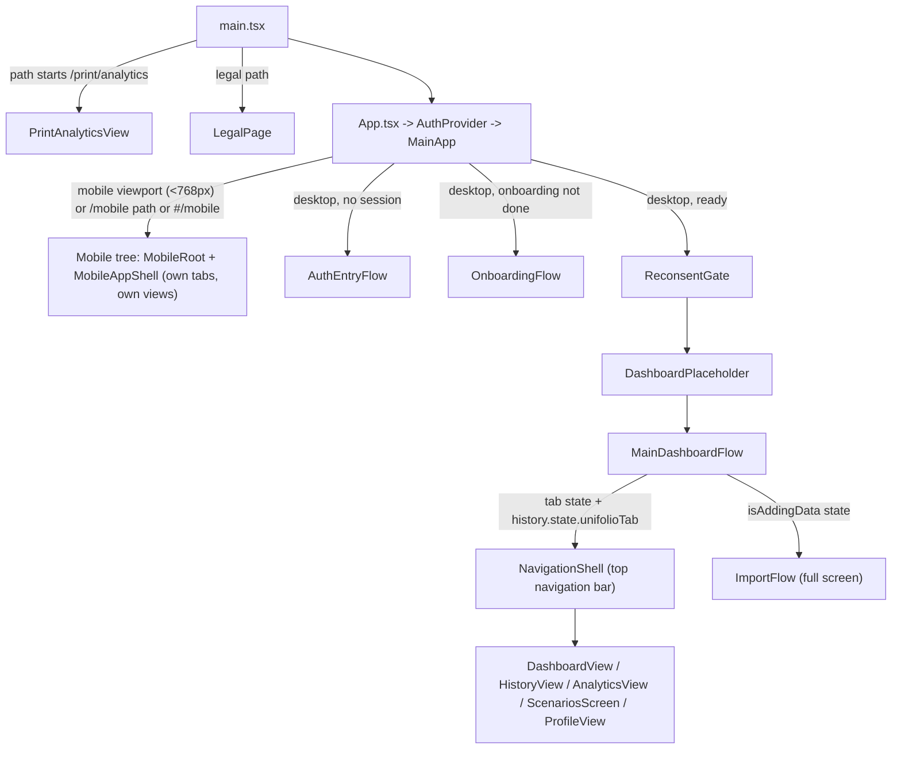
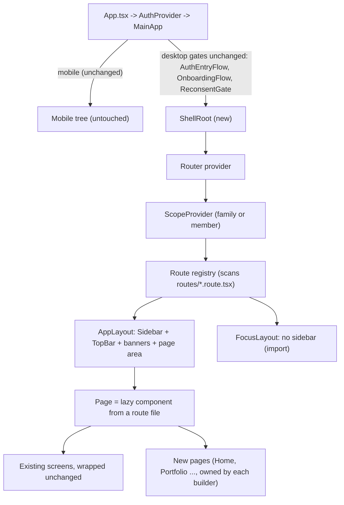
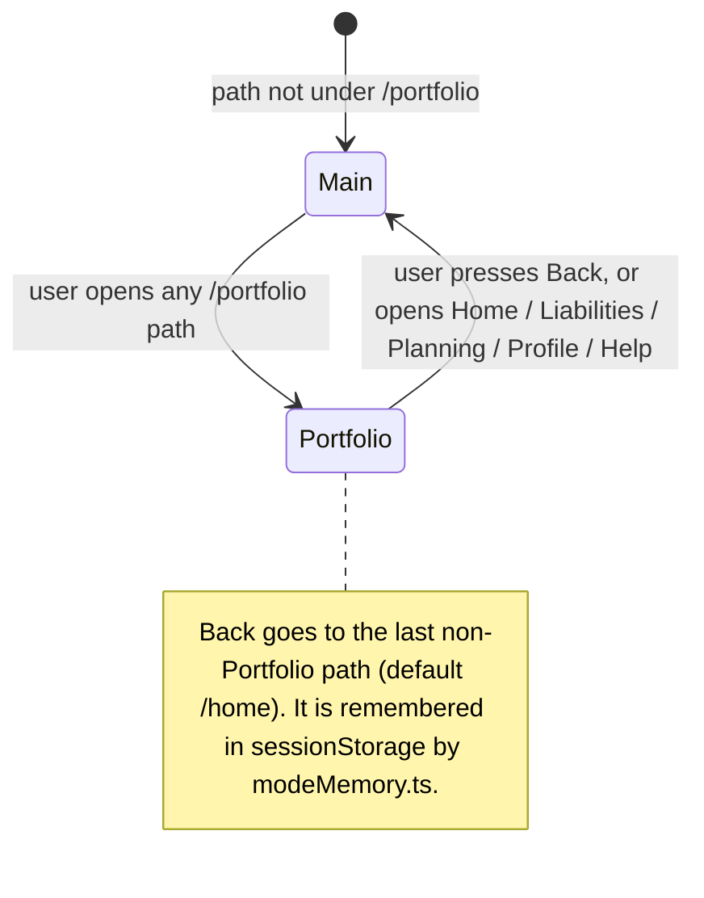

# Navigation shell and router: structure, design and how it fits the current code (draft v1.2)

**Status:** draft for review, written 2026-10-22. Planning only; nothing is built. This is the in-depth companion to `2026-10-22-nav-shell-contract-v1.md` (contract v1.2 and URL map). The contract says *what pages can rely on*; this document says *how the shell is structured and how it meets the code that exists today*. The shell's step-by-step implementation plan is written after both are agreed.

**Scope boundaries (from the product owner, 22 Oct):**
- **Mobile is out of scope.** The mobile app is not touched: no bottom-bar change, no new mobile routes, no mobile design.
- **Existing screens are not changed, rebuilt or split.** Dashboard, History, Analytics, Scenarios, Profile and the import flow stay exactly as they are; the manager is building the new pages. The shell wires them in unchanged through thin wrapper files, with no edit inside the screens (decision L38).
- **Light and dark themes only.** No extra accessibility targets in this phase (decision L33).

## 1. Goals and non-goals

**Goals**
- Real URLs for every desktop screen, so deep links, refresh and the browser back button work.
- A left sidebar with two modes (main, Portfolio) and a top bar, driven by a registry of route files.
- One place that holds the family-or-member scope, so every page re-scopes the same way.
- Pages added by adding a file, with no merge conflicts on a shared menu file.

**Non-goals**
- Anything on mobile.
- Changing what an existing screen does or looks like.
- Building the new pages themselves.
- Changing the backend.

## 2. How the app is wired today (verified in the code)



Key facts:
- `main.tsx` already sends `/print/analytics` and the public legal pages around `App`. The router must never capture those.
- The desktop shell today is a **top navigation bar** (`NavigationShell`), and the "which screen" state is a React state plus `window.history.state.unifolioTab`. It is the only code that touches `window.history`.
- Family-or-member state (`viewMode`, `selectedMemberId`, the member list and raw members), the "Add data" mode, the dev `ImportHealth` page, the PAN conflict banner, the profile nudge and `CompleteProfileDialog` all live inside `MainDashboardFlow`.
- Only three test files reference the current shell: `App.test.tsx`, `MainDashboardFlow.test.tsx`, `NavigationShell.test.tsx`.
- Hosting already supports real URLs: Caddy on the LeapSwitch VM uses `try_files {path} /index.html`, and the AWS CloudFront distribution maps 403 and 404 to `/index.html`. No infrastructure change is needed for deep links or refresh.

## 3. Target structure



**Rule of the boundary:** the router is mounted only in the desktop branch of `MainApp`, after the existing gates. The mobile branch, the print route and the legal pages never see it.

### 3.1 Folder layout (proposed)

```
frontend/src/shell/
  index.ts                     public API (what pages import)
  ShellRoot.tsx                mounts router + providers, replaces DashboardPlaceholder
  registry/
    types.ts                   the ShellRoute type (contract section 5)
    buildRegistry.ts           import.meta.glob + sorting + validation (group nodes have no page, only a redirect path; every child names its group as parent)
    registry.test.ts           the contract test
  routes/                      ONE FILE PER PAGE (the only folder page owners touch)
    home.route.tsx
    portfolio.route.tsx
    portfolio-equity.route.tsx   (group node: kind "group", path /portfolio/equity only to redirect to /portfolio/mutual-funds, no page; children are separate route files)
    ...                        (one per row of the URL map)
  layout/
    AppLayout.tsx              sidebar + top bar + banners + <Outlet />
    FocusLayout.tsx            no sidebar (import)
    Sidebar.tsx                renders main or Portfolio mode from the registry; renders group nodes (Equity) as an expand/collapse row with indented children
    TopBar.tsx                 search, Ask Mira, family selector, theme toggle
    PageLayout.tsx             standard page header (title, subtitle, actions, tabs)
    PageState.tsx              loading, empty, error
  scope/
    ScopeProvider.tsx          moved logic from MainDashboardFlow
    useScope.ts
    MemberBanners.tsx          PAN conflict banner, profile nudge, CompleteProfileDialog
  nav/
    paths.ts                   typed link builders
    AppLink.tsx, useAppNavigate.ts
    modeMemory.ts              remembers the last non-Portfolio path (for Back)
  mira/MiraComingSoonDialog.tsx
  testing.tsx                  renderInShell
```

### 3.2 The router

- **Library:** a mainstream React router (react-router), in declarative mode: a browser router, `Routes`/`Route`, `Outlet`, `NavLink`, `useNavigate`, `useLocation`. It is the one new dependency (decision F2, confirmation O1). **react-router `^7.18.4`** (owner decision O1 and A1, 22 Oct). Checked: 7.18.4 needs Node 20 or later and React 18 or later, which fits our Node 20 builds in CI and `deploy.sh`; v8.5 needs Node 22.22, so a v8 upgrade is a later task. Declarative mode lists BrowserRouter, MemoryRouter, Routes, Route, NavLink, Outlet, useNavigate and useLocation. Route-level `lazy` is not documented for declarative mode, so each route file loads its page with `React.lazy` and `Suspense`.
- **URL style:** real paths (`/portfolio/mutual-funds`), not hash routes. Hosting already falls back to `index.html` (section 2).
- **Code splitting:** each route's component is a dynamic import, wrapped in `Suspense` with `PageState` loading. Only the registry metadata is loaded eagerly.
- **Redirects:** `/` goes to `/home`; `/planning` goes to `/planning/scenarios`; unknown paths go to the shell's not-found page.
- **No guards inside the router.** Authentication, onboarding, consent and pending-deletion stay as the gates they are today; the shell mounts only for a ready user.

### 3.3 The registry

- Built once at startup with `import.meta.glob("./routes/*.route.tsx", { eager: true })`. Each file default-exports its `ShellRoute` (the contract's section 5).
- Sorted by `section` then `order`. The sidebar reads it; so does the router.
- **Validation** runs in a unit test and, in development, at startup: unique ids and paths, every URL-map path has a file, parents exist, every menu item has a label and icon.
- A route's `status` (`live` or `placeholder`) drives disabled links (section 6).

### 3.4 Layouts

- **AppLayout:** fixed-width left sidebar, a top bar above the page area, the member banners above the page content, then the page. It is desktop only. Below 768 px the existing mobile tree takes over exactly as today (the router is not involved).
- **FocusLayout:** used by `/import`: a minimal header with a Back link and the theme toggle, as the current "Add data" screen has.
- Both use the existing theme tokens in `src/styles/tokens.css`; nothing new is hard-coded.

### 3.5 The sidebar

State is derived from the URL; there is no separate "mode" state to get out of sync.



- Main mode lists the `main` section; Portfolio mode lists `portfolio` items with a Back row on top; the footer group (Profile, Help & Support) is the same in both.
- Active item: the registry route whose path equals the URL or is its longest prefix. Everything under `/portfolio/mutual-funds` highlights Investments.

### 3.6 The top bar (decisions L31, L39)

Search box, Ask Mira, the family selector, the theme toggle. **No avatar**; Profile is in the sidebar footer. The search box is one box with a dropdown of three groups (Your funds, All funds, Ask Mira); in the shell's first version it opens the shared "Mira, coming soon" popup, and the real search is a follow-up (a new `GET /funds/search` endpoint plus the dropdown), specified in the Portfolio Snapshot workbook (G2).

## 4. The family-or-member scope

Today's logic moves, unchanged in behaviour, from `MainDashboardFlow` into `ScopeProvider`:

- Fetch the members with `getHouseholdMembers()` on mount and when the account (`me`) changes.
- One member means member mode; several mean aggregate mode with the first member preselected.
- `handleMemberSelect` becomes `setMember(id)`; the "Family Combined" choice becomes `setAggregate()`.
- `refreshMembers()` after a rename, merge or import, plus `invalidateApiCache()` where `MainDashboardFlow` calls it today.
- The raw member (profile completion, PAN conflict) is exposed as `selectedMember` so the banners can render. The banners and `CompleteProfileDialog` move into `MemberBanners`, shown for single-member scope on every page except Profile, as today.
- The scope is **not** in the URL (O4). It is held in the provider and kept for the browser-tab session, so a refresh keeps it.
- **Scope rule (owner, B1, confirmed 23 Oct):** every page change shows Family Combined, including the first Portfolio page and moves between Portfolio pages, except moves between the in-page tabs of one page (confirmed 23 Oct). A pick holds while the user stays on that page or its tabs; a refresh keeps it. It applies to households with several members; one member stays in member mode. Detection: in the provider, when the location pathname changes, resolve the previous and next routes from the registry, trace each up its `parentId` chain to the nearest route with a sidebar row, and reset only if the two rows differ. This also keeps the pick when a fund page opens from a Mutual Funds tab (confirmed 23 Oct, contract section 10, item b).

## 5. How the existing screens connect without being changed (decision L38)

Each existing screen gets a thin wrapper route file that reads the scope and renders the unchanged component with the props `MainDashboardFlow` passes today. **The screens themselves are not edited.**

| Screen (unchanged) | Props it needs today | Where each prop comes from in the wrapper |
|---|---|---|
| `DashboardView` | `importNotice`, `onDismissImportNotice`, `viewMode`, `memberId`, `onAddDataForMember`, `onOpenHistory` | scope hook; the import notice from router location state; `useImport().openImport`; `onOpenHistory` navigates through `paths` |
| `HistoryView` | `viewMode`, `memberId`, `memberName` | scope hook |
| `AnalyticsView` | `viewMode`, `memberId`, `onAddDataForMember`, `activeMemberName` | scope hook; `useImport()` |
| `ScenariosScreen` | none | none |
| `ProfileView` | `onOpenImportHealth`, `name`, `email`, `phoneNumber`, `logout`, `requestAccountDeletion`, `requestContactChange`, `verifyContactChange`, `onMembersChanged` | `useAuth()`; navigation to `/profile/import-health`; `refreshMembers` |
| `ImportFlow` | `householdMemberId`, `onDone(notice)` | the `?member=` query (or the chooser when absent, as today); on done, navigate to the Mutual Funds route with the notice in location state |
| `ImportHealth` | `memberId`, `onBack` | scope hook; navigate back |

## 6. Links and "not built yet" pages (decision L32)

- Every page links through `paths.*`, never a hard-coded string.
- `<AppLink>` checks the target route's `status`. If it is `placeholder`, the link renders **disabled** (muted, not clickable, with a tooltip "Coming soon"). When the owner replaces the placeholder and flips `status` to `live`, every link to it starts working with no change in the pages that link to it.
- The table of Home links and their destinations is in the Portfolio Snapshot workbook (G3 reply).

## 7. Navigation behaviour

- **Back and forward** work through the router; the `unifolioTab` history-state code is removed with `MainDashboardFlow`.
- **Deep links and refresh** work on every path (hosting fallback verified in section 2).
- **Landing (decision L35):** after login the user lands on `/home`. After sign-up the order is authentication, onboarding, CAS upload, then `/home`. A deep link to a valid path is respected once the gates pass.
- **Page title:** each route's `title` sets `document.title` ("<title> · Unifolio").
- **Scroll:** scroll resets to the top on navigation within the page area.
- **404:** the shell's not-found page, inside the layout.

## 8. What changes in the current codebase

| Area | Change |
|---|---|
| `frontend/package.json` | add the router library (one dependency) |
| `App.tsx` | in the desktop branch only, `DashboardPlaceholder` is replaced by `ShellRoot`; mobile branch, auth, onboarding, consent and deletion logic untouched |
| `main.tsx` | unchanged (print and legal routes keep bypassing `App`) |
| `features/dashboard/MainDashboardFlow.tsx` | its state and handlers move into the shell (scope, import, banners); the file is retired once the wrappers exist |
| `features/dashboard/NavigationShell.tsx`, `DashboardPlaceholder.tsx` | retired (the top navigation bar is replaced by the sidebar and top bar) |
| Tests | `App.test.tsx`, `MainDashboardFlow.test.tsx` and `NavigationShell.test.tsx` need updating; new shell tests are added |
| New | everything under `frontend/src/shell/` (section 3.1) |
| **Untouched** | all of `features/*` screens, `mobile/**`, auth, onboarding, legal, the print route, theme tokens, the whole backend, Caddy and CloudFront configuration |

## 9. Mobile (out of scope)

- The mobile app keeps its own tab state and views; nothing about it changes.
- The branch decision in `MainApp` (viewport under 768 px, or a `/mobile` path or `#/mobile` hash) runs **before** the router mounts, so the router never sees mobile.
- A desktop window narrowed below 768 px switches to the mobile tree as it does today; widening it again returns to the shell at the same URL.
- Route files carry no mobile fields.

## 10. Build sequence (two PRs, owner answer D1: steps 1 to 3, 5 and 8 are PR 1, not yet switched on; steps 4, 6 and 7 are PR 2; each step testable alone)

1. Add the dependency; mount an empty router behind an unused path; confirm nothing changes.
2. Registry, placeholder route files for every URL-map row, and the contract test.
3. `AppLayout`, `FocusLayout`, `Sidebar` (including the expandable Equity group and its remembered open state), `TopBar`, `PageLayout`, `PageState`.
4. `ScopeProvider` and `MemberBanners` (moved logic), with tests for default mode, switching and refresh.
5. `paths`, `AppLink` (including disabled links), `useImport`, `MiraComingSoonDialog`, `renderInShell`.
6. The wrapper route files for the existing screens, with tests for deep link, refresh, back and forward.
7. Switch `App.tsx`; retire `MainDashboardFlow`, `NavigationShell`, `DashboardPlaceholder`; update the three test files.
8. The "how to add a page" guide.

## 11. Risks

| Risk | Mitigation |
|---|---|
| Moving state out of `MainDashboardFlow` changes behaviour (member defaults, banners, import notice) | Move logic without rewriting it; port the existing `MainDashboardFlow` tests first; manual check against the old behaviour on staging |
| A route file breaks the whole menu | Contract test and startup validation fail loudly; the test also checks that a group node has children and no page, and that `/portfolio/equity` only redirects to `/portfolio/mutual-funds` |
| react-router v7 API differs from the declarative-mode API assumed here | Verify the installed version before step 1 and adjust this document; the scope-rule tests use `MemoryRouter` |
| Router captures `/print/analytics` or legal pages | They bypass `App` in `main.tsx` before the router exists; add a test |
| Real URLs break on a server without fallback | Verified for Caddy and CloudFront; add a note to the deploy guides |
| The shell and a page PR collide | Pages touch only their route file and feature folder; shell changes are their own PR |

## 12. Open items (from the contract, section 10)

All answered 22 Oct (see contract section 10): O1 react-router v7; O2 Equity is an expandable group with four children, no page of its own; O4 no scope in the URL; O5 no Planning sub-menu; O6 Liabilities placeholder (assumed); O9 last non-Portfolio screen; O10 later; O11 placeholder. Confirmed in the Left Panel Plan (22 Oct): FDs & bonds sits under Equity; Equity opens on child pages and otherwise remembers its state; `/portfolio/equity` redirects to `/portfolio/mutual-funds`; the scope rule (Family Combined on every page change, except between the in-page tabs of one page). Also confirmed (23 Oct): the `direct-stocks` slug and the fund-page case of the tab exception. Nothing is left to confirm. Closed earlier: O3, O7, O8 (mobile out of scope) and O12 (existing screens are wired by wrapper files only, decision L38).
