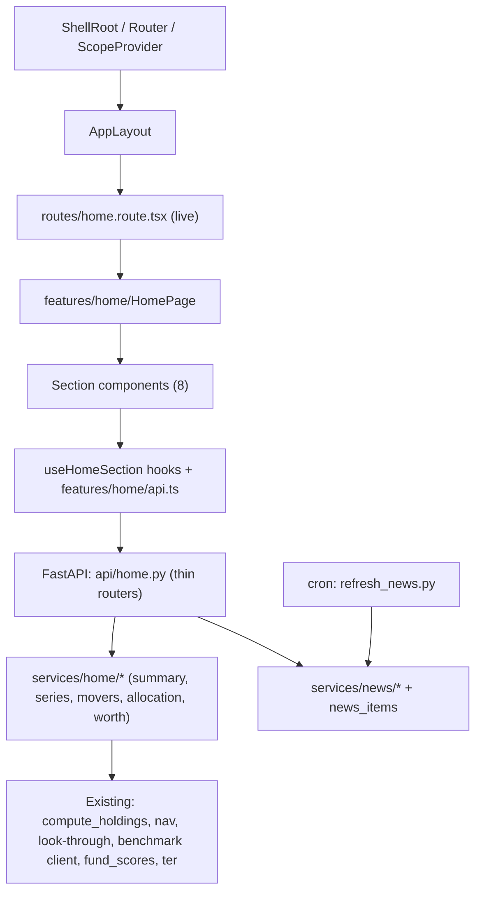

# Home: architecture (extends the nav-shell architecture, draft v1)

**Status:** draft, 2026-10-23. Doc 6. Extends `2026-10-22-nav-shell-architecture.md` (not edited). Shell contract v1.2.

## 1. Where Home sits



Home touches only its route file and `features/home/`. Backend adds `api/home.py` (registered in `main.py`), `services/home/`, `services/news/`, migrations, one job.

## 2. Backend structure

- `api/home.py`: routers mirroring the Dashboard scoping pattern (`/household/aggregate/home/*`, `/household-members/{id}/home/*`, `/home/benchmarks`, `/home/news`); same auth/ownership dependencies.
- `services/home/`: one module per section; pure functions take loaded rows, so the heavy logic is testable without a DB. They call `compute_holdings` once per request and share the result across sections via a per-request memo.
- `services/news/`: `ingest.py` (GDELT files), `normalise.py`, `match.py` (ladder), `score.py` (per-user, request time), `config.py` (kill switch, thresholds).
- Sync SQLAlchemy sessions stay sequential; commits use `commit_off_loop` as elsewhere. No new framework, no new service deployment (monolith rule).

## 3. Compute and trigger model

Home computes on request from existing tables; Dashboard computes only when its own page opens; Analytics stays stored and precomputed. Home never starts a recompute. Detail and diagrams: flow doc. Risks carried: per-worker holdings cache; opening-balance route not invalidating the cache; XIRR cost (not on Home); stale-today NAV re-download (use allow-stale-today).

## 4. Frontend structure

```
features/home/
  HomePage.tsx, api.ts, useHomeSection.ts, homeFormat.ts
  sections/ Greeting, WealthCard, Glance, Allocation, Movers, WorthALook, News
  components/ PeriodSelector, DateRangeCalendar, BenchmarkSelect, ChangeBadge, ...
components/ui/charts/line-area-chart.tsx   (shared chart, reusable by Portfolio pages)
```

## 5. Shell patches still pending, checked on disk

The three patches the owner rejected on 22 Oct (Sidebar and registry notes for the Equity group, build step 3, a router-version risk row) **already appear in the working-tree copy of the shell architecture** (Sidebar line, step 3 wording and the react-router row are present; the file shows as modified, uncommitted, by another session). No further edit made. Remaining small gaps for the owner to approve: a one-line "search on hold" note in the contract and architecture top bar sections (L46); and the contract's open item (a) `direct-stocks` slug.

## 5a. Additions after the 23 Oct answers

Usage tracking is **deferred** (PRIORITY 2 in `DEFERRED_FEATURES.md`; plan in `2026-10-23-home-tracking-ga4-plan.md`); disclosure retention goes from 3 to 6 months in `portfolio_disclosure_retention.py`; links to unbuilt pages stay greyed (L32); `compute_holdings` needs an optional `allow_stale_today` pass-through (P7).

## 6. Cross-cutting

- Security: new routes behind existing auth; news endpoint returns only public headline data plus per-user chips; no user data sent to GDELT or any external service. Heartbeat sends no user data.
- Observability: job logs, heartbeat, `news_enabled` kill switch.
- Rollout: no feature flag (L19); staging is the test bed; news ships dark first.
- Mobile/print/legal: untouched.

## 7. Architectural decisions proposed

Recorded in `2026-10-23-home-backend-decisions-proposal.md` (not appended to `decisions.md`).
