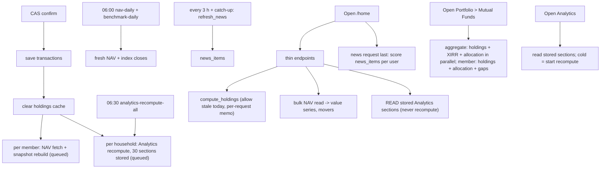

# Home: user flows and compute/trigger flows (draft v1)

**Status:** draft, 2026-10-23. Doc 8. Base: the F3 reply in the decision record. All facts verified in code on 22 Oct.

## 1. Landing

```mermaid
flowchart LR
  L[Login] --> A[Authentication] --> H[/home]
  S[Sign-up] --> A2[Authentication] --> O[Onboarding] --> C[CAS upload + confirm] --> H
  H -->|no holdings| E[Empty Home: Import button]
  H -->|import running| P[Skeletons + note]
  H -->|import failed| F[Banner + retry]
```

A deep link to a valid path is respected once the gates pass.

## 2. In-page user flows

- Change period → refetch wealth-series only. Pick benchmark → refetch wealth-series. Custom → calendar (≤10 years).
- Pick a member (selector or family bar) → every section refetches in that scope; reset to Family Combined on any page change except between one page's tabs.
- Movers dropdown → refetch movers; bar click → popup → fund (disabled until live).
- Understand / Ask Mira → coming-soon dialog. News item → publisher in a new tab. Return to tab → news refetch (throttled 5 min).

## 3. What is computed when



### Answer to "compute Home and Dashboard together or on separate triggers?"

Separate. Home computes only what Home shows, on Home's open; the Dashboard computes (including the 0.7-1.0 s XIRR) only on its own page open. Import confirm keeps queuing the same background work as today. Home adds no background work except the news job. If the staging measurement misses 1.5 s, the fallback is precomputing the daily series after import confirm and in the 06:30 job; that is a plan-time decision, not v1.

### Replacing the Dashboard by Home

Home becomes the landing page. The Dashboard is not removed: it is wrapped unchanged at `/portfolio/mutual-funds` (L38). Its compute is unchanged and triggers only when that route opens.

## 4. Risks in the flow

Per-worker holdings cache (3 workers, 15 min); opening-balance route does not invalidate the cache; full NAV re-download when no row is dated today (use allow-stale-today); XIRR slow (kept off Home).
