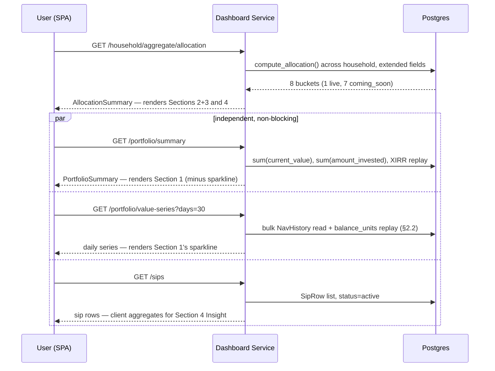
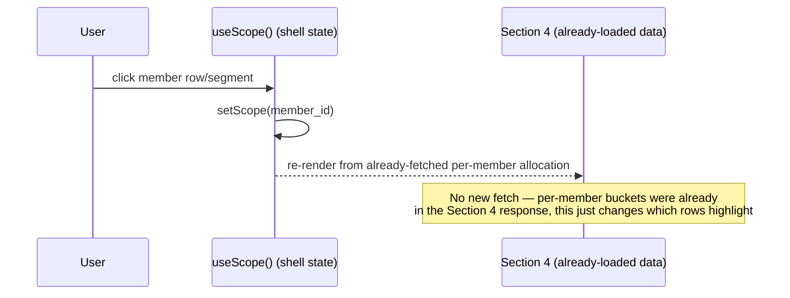
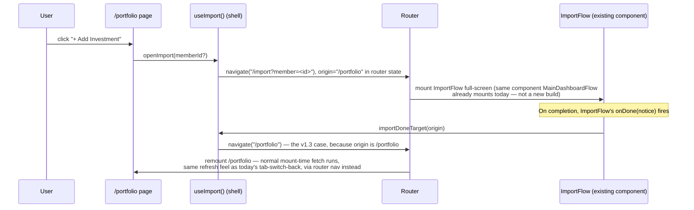

# Portfolio Home Page (`/portfolio`, "Investments") — Design Document

**Status:** draft, written 2026-10-23; builder-check done, all three findings resolved by the owner (§8); PRD/technical-design/architecture/flow sections added (§9-§12) to close the "one consolidated artifact" requirement; §12 Journey C's "+ Add Investment" mechanism resolved — updated 2026-10-23 to use the shell's own `useImport()`/`openImport()` and the nav-shell contract v1.3 origin-aware `importDoneTarget()`, replacing this document's earlier invented `/import?returnTo=/portfolio` one-off (no shell contract change needed beyond the v1.3 already made for this page; see §4, §6, §10, §12). No open items remain in the functionality/backend/flow design. Pending: the hi-fi visual+states artifact's design system is being corrected to match the owner's reference screenshot (§13), then final sign-off. Nothing built yet.
**Route id (per nav-shell contract v1.2):** `portfolio` — path `/portfolio`, label "Investments", icon `LayoutGrid`, menu section `portfolio` order 1, layout `app`, scope `family-or-member`.
**Mockup history:** `Docs/orchestration/2026-10-22-portfolio-home-page-skeleton-mockup-v1.html` through `-v8.html`, superseded by `Docs/orchestration/2026-10-23-portfolio-home-page-skeleton-mockup-v9.html` (v9 is final/locked, adds the 8-slice taxonomy + full XIRR reuse per §8). Brainstorming transcript is the record of every decision below; this document is the write-up.

---

## 1. Scope

This is the MF-only MVP (`CLAUDE.md`). Confirmed independently from the backend (Section 2.5 below) and consistent with the parallel Home-screen effort's own scoping: **mutual funds are the only live asset class on this page.** Direct Stocks, US Stocks, FDs & Bonds, Gold, and Real Estate are shown in the UI (sidebar entries, pie slices) because the nav-shell contract already reserves those routes, but none of them have a backend data model yet. They render as **"Coming soon"** — visible, disabled, no data — not hidden and not functional.

**In scope for this document:** the `/portfolio` page's 4 sections, their backend endpoints/schema changes, and the page's own wiring into the nav shell.

**Out of scope, explicitly:**
- Building the Direct Stocks / US Stocks / Gold / FDs & Bonds / Real Estate data models. Deferred; tracked as a follow-up in `DEFERRED_FEATURES.md` once this page ships.
- `/portfolio/mutual-funds` (the existing `DashboardView`) itself — untouched by this work except that the Sync Investments button moves there (deferred further, to MF Central integration). The XIRR Lifetime/Current toggle + Chandra Tripathi disclaimer stays on `/portfolio/mutual-funds` **and** is also reused as-is on this page's Summary Strip (§2.1, §8 item 2) — same component in both places, not a fork.
- Search (shell contract still shows a search box in the top bar; out of scope per the shell session, not re-litigated here).
- The left sidebar / router itself — owned by the nav-shell session, this page only consumes it.

---

## 2. Functionality + backend structuring plan

### 2.1 Section 1 — Summary strip (entirely new widget)

Not reused from `DashboardView` — today's dashboard has no equivalent row. Five metrics, each with an ⓘ info icon (hover tooltip explaining the number and its source — standing rule, applies to every metric on this page and every future mockup):

| Metric | Source | Notes |
|---|---|---|
| Total Portfolio Value | `sum(HoldingRow.current_value)` across valued holdings, family-combined or member-scoped per `useScope()` | Existing aggregation, already computed for the Dashboard's own total |
| — sub-line: Today's Gain | `sum(HoldingRow.today_gain)` | Field already exists per-holding; this is a new aggregate sum, trivial |
| — sparkline | **New**, see §2.2 | |
| Total Invested | `sum(HoldingRow.amount_invested)` | Existing |
| Unrealised Gain | `sum(HoldingRow.unrealized_gain)` + % | Existing |
| Realised Gain | `RealizedSummary` total | Existing |
| XIRR | Whole-portfolio XIRR, with the full Lifetime/Current toggle + opening-cost disclaimer | **Reused-as-is from the Dashboard** (resolved, see §8 item 2) — same component, same calculation, same `XirrDisclaimerModal`, placed here as well as on `/portfolio/mutual-funds` |

No new backend work for any of these except the sparkline and the today_gain sum (one `sum()` over an already-fetched list — free). Quick Insight #5 and the strip's own `sum(SipRow.sip_amount)` need a small new endpoint, not reuse — corrected in §2.4.

### 2.2 Total Portfolio Value sparkline — new, feasible without a new table

Checked independently against the actual schema: `Transaction.balance_units` already stores the running cumulative unit balance per folio after every transaction (`backend/app/models/transaction.py`), and `NavHistory` already holds daily NAVs per scheme back to 2006. That means a daily portfolio value series can be built **without a new persisted table**:

1. For each folio in scope, find its most recent transaction with `date <= d` and read `balance_units`.
2. Multiply by that scheme's NAV on day `d` (one bulk `NavHistory` read for the whole date range, not a per-day query).
3. Sum across folios for each `d` in the window.

This is the same shape of computation the Analytics service already does for per-fund NAV history, just replayed across a short window (the sparkline only needs the last ~30 days, not a selectable period) and summed across folios instead of shown per-fund. **New backend work:** one service function (`compute_daily_value_series`, scoped by date range and household-member set) + one thin endpoint. Moderate, not trivial — flagged as a real task, not a one-liner.

### 2.3 Section 2+3 — Asset Allocation pie + legend (reused data, extended schema)

Pie slices: Mutual Funds (live), plus one slice per non-MF sidebar route (Coming soon) — matching the nav-shell contract exactly, resolved per §8 item 1: **eight slices total** — Mutual Funds, Direct Stocks, US Stocks, FDs & Bonds, Debt, Gold, Real Estate, Others. The v8 mockup (six slices, missing Debt and Real Estate) is superseded by v9, which adds the two missing slices/legend rows as Coming soon entries in the same muted style as the rest.

**Backend-driven status, not hardcoded in the frontend:** each slice's `status: "live" | "coming_soon"` comes from the API response, mirroring how `ShellRoute.status` already works for routes. When a new asset class is built, it starts returning real numbers; the frontend doesn't need a redeploy to stop treating it as a placeholder. This is the same logical shape as the route registry's own `status` field — not copied from anywhere else, just the obvious consistent answer given the pattern already exists in this codebase.

**Schema change needed:** `AllocationBucket` (`backend/app/services/dashboard/schemas.py`) currently has only `label` / `current_value` / `percentage`. The hover popup needs `invested`, `gain_loss`, and `xirr` per bucket too. Extend:

```python
class AllocationBucket(BaseModel):
    label: str
    current_value: str
    percentage: str
    status: Literal["live", "coming_soon"] = "live"
    invested: str | None = None       # None for coming_soon buckets
    gain_loss: str | None = None
    xirr: str | None = None
```

`compute_allocation()` (`backend/app/services/dashboard/allocation.py`) already groups holdings by value; extend the same loop to also sum `amount_invested` and `unrealized_gain` per bucket (trivial, same loop). Per-bucket XIRR is the one real addition: it needs the existing XIRR cash-flow replay, scoped to only the transactions belonging to holdings in that bucket — reuses the existing XIRR calculation, just filtered input, not a new algorithm.

Sort/filter (new, this round): Filter + Sort buttons in the card header, default sort ascending by allocation %. **Filter v1 (confirmed):** live vs. coming-soon only — toggling it hides/shows the coming-soon buckets. Deliberately minimal: with only 1 live category today there's nothing else meaningful to filter by. **Deferred, tracked in §7:** once more asset classes go live, Filter needs a proper redesign (by value range, by AMC, etc.) — this v1 toggle is not meant to be the permanent shape. Both are client-side over the same response; no backend change beyond returning the buckets (already does).

### 2.4 Section 4 — Family allocation + Quick Insights

Per-member breakdown (segmented bar + row list) reuses `useScope()`'s existing member list and `compute_allocation()` called per member (already an existing endpoint: `GET /household-members/{member_id}/allocation`). No new backend work — this is the same call already used elsewhere, just rendered as a bar instead of a table.

**Member row/segment click → scope switch.** Confirmed: clicking a row or bar segment calls `useScope()`'s existing member-switch (the same mechanism `NavigationShell.tsx` already uses for its aggregate/member toggle). Same page, same URL, zero new routing, zero new backend work. **Resolved, see §8 item 3:** per nav-shell contract v1.2, scope resets to Family Combined on every page change except between tabs of the same sidebar row — so picking a member here and then clicking through to the Mutual Funds slice resets to Family Combined. Confirmed intended: this page follows the same cross-page scope-reset rule as the rest of the shell, no exception needed.

**Quick Insights (5, always meaningful regardless of portfolio shape):**

| # | Insight | Query |
|---|---|---|
| 1 | "Your largest holding is X — Y% of your total portfolio" | `max(HoldingRow.current_value)` |
| 2 | "Spread across N AMCs and M funds" | distinct `amc_name` count, holdings count |
| 3 | "X% Direct, Y% Regular" | split of `plan_type` by value |
| 4 | "Your largest single AMC exposure is X%" | top of `AllocationSummary.by_amc` |
| 5 | "₹X in active SIPs scheduled this month" | `sum(SipRow.sip_amount)` where `status == "active"` |

All five are drawn from fields that already exist (`HoldingRow`, `AllocationSummary.by_amc`, `SipRow`) — **correction from the builder-check:** insight #5 and the Summary Strip's SIP figure were wrongly marked "no new backend work" — there is no `GET /household-members/{id}/sip-summary` endpoint, only `/sips` and `/sips/monthly` (full row lists), and the `SipSummary` schema exists but is unwired. Fix: the frontend aggregates client-side from the existing `/sips` list, the same way `DashboardView` already does — no new endpoint needed, just reuse the existing list call instead of inventing a summary call. Each insight always produces a non-trivial value for any portfolio with at least one holding (the page's own empty state, not these insights, handles a zero-holding family).

### 2.5 Backend gaps confirmed, explicitly deferred

- No data model for Direct Stocks, US Stocks, FDs & Bonds (non-MF), Gold, or Real Estate holdings. `asset_class_bucket()` only ever returns `Equity` / `Debt` / `Hybrid` / `Other` — all within mutual fund SEBI categories. Building these is out of scope for this page; tracked for later (§1).
- No portfolio-level historical value table existed before this plan — resolved in §2.2, no new table needed.

---

## 3. Layout skeleton

```
┌─────────────────────────────────────────────────────────────┐
│ Investments (crumb)                              [+ Add      │
│ All Investments                                   Investment]│
│ View and manage your complete family portfolio...            │
├─────────────────────────────────────────────────────────────┤
│ SECTION 1 — Summary strip (new widget)                        │
│ [Total Portfolio Value + sparkline]  [Invested]  [Unrealised] │
│ [Realised]  [XIRR]                                             │
├─────────────────────────────────────────────────────────────┤
│ SECTION 2+3 — Asset Allocation                 [Filter][Sort] │
│   ┌───────────┐   Mutual Funds      48.2% ›                   │
│   │   PIE     │   Direct Stocks     24.0% ›  (Coming soon:    │
│   │  (8 slice)│   US Stocks          8.1% ›   muted, disabled)│
│   └───────────┘   FDs & Bonds       10.4% ›                   │
│                    Debt               3.0% ›                  │
│                    Gold               4.1% ›                  │
│                    Real Estate        2.1% ›                  │
│                    Others             5.2% ›                  │
├─────────────────────────────────────────────────────────────┤
│ SECTION 4 — Family allocation + Quick Insights                │
│  [segmented bar: member1 | member2 | member3]                 │
│  row: avatar  name  mini-bar  value (%)  ›                     │
│  row: avatar  name  mini-bar  value (%)  ›                     │
│  ─ Quick Insights ──────────────────────────                  │
│   5 always-meaningful one-line insights                       │
└─────────────────────────────────────────────────────────────┘
```

Matches `2026-10-22-portfolio-home-page-skeleton-mockup-v9.html` (v9 supersedes v8, adding the Debt and Real Estate slices per §8 item 1); that file is the authoritative visual reference, this is the textual skeleton for anyone who can't open it.

---

## 4. Data flow

```
/portfolio page mount
  │
  ├─ useScope() → { scope: "family" | member_id }
  │
  ├─ GET /household/aggregate/allocation  (or /household-members/{id}/allocation)
  │     → AllocationSummary (extended: status, invested, gain_loss, xirr per bucket)
  │     → feeds Section 2+3 pie/legend AND Section 4's per-member bars
  │
  ├─ GET /portfolio/summary  (NEW thin endpoint over compute_holdings — corrected,
  │     did not exist; today_gain sum is new but trivial)
  │     → feeds Section 1
  │
  ├─ GET /portfolio/value-series?days=30  (NEW, §2.2)
  │     → feeds Section 1's sparkline
  │
  └─ GET /sips  (existing list endpoint — corrected, no sip-summary endpoint exists;
        aggregate client-side the same way DashboardView already does)
        → feeds Section 4's Quick Insight #5 and Section 1's SIP figure if shown
```

Click flows:
- Pie slice / legend row (live asset class) → `AppLink` to its route (`/portfolio/mutual-funds`, etc.) — direct navigation, no modal.
- Pie slice / legend row (coming-soon asset class) → disabled, no navigation (per shell contract's "links to pages that don't exist yet are disabled" pattern already used elsewhere).
- Member row / bar segment → `useScope()` switch, same page. Resetting to Family Combined on navigating away (e.g. into the Mutual Funds slice) is intended shell behavior, confirmed per §8 item 3 — no exception needed here.
- "+ Add Investment" → **resolved this round, revised 2026-10-23.** No new picker UI (only mutual funds live, nothing else to pick between yet). Calls the shell's own `useImport().openImport(memberId?)` — the same hook `DashboardView`/`AnalyticsView` already use for their "Add data" entries — which navigates to `/import?member=<id>` with `/portfolio` recorded as the origin, and mounts the existing `ImportFlow` component full-screen (no new route, no `returnTo` query param; that was this document's own earlier invention, replaced because the shell already has an origin mechanism). On completion, `ImportFlow`'s `onDone` is resolved through the shell's `importDoneTarget(origin)` (nav-shell contract v1.3): because the origin is `/portfolio`, it navigates back there, remounting the page and triggering its normal mount-time fetch — reproducing today's "switch back to the dashboard tab" refresh behavior exactly. Every other origin (Dashboard, Analytics) is unaffected by this change — they still always land on `/portfolio/mutual-funds` as before.
- ⓘ info icon → hover tooltip, no navigation.
- Filter / Sort → client-side re-order of the legend list, no navigation.

---

## 5. Per-section reuse classification

| Section | Classification | Detail |
|---|---|---|
| Page header (crumb / title / subtitle / Add Investment) | **Entirely new** | No equivalent exists today |
| 1 — Summary strip | **Entirely new**, except XIRR | Strip itself has no Dashboard equivalent; its XIRR metric specifically is **reused-as-is** — same Lifetime/Current toggle + `XirrDisclaimerModal` component as the Dashboard, not forked |
| 2+3 — Asset Allocation pie | **Reused-but-updated** | `compute_allocation()` and `AllocationSummary` already exist; extended with `status`/`invested`/`gain_loss`/`xirr` |
| 4 — Family allocation bar + rows | **Reused-but-updated** | Per-member `compute_allocation()` calls already exist; new rendering only |
| 4 — Quick Insights | **Entirely new** | New presentation; all underlying fields already exist |
| Member scope switch | **Reused-as-is** | `useScope()` / `NavigationShell.tsx`'s existing aggregate/member mechanism, unchanged |

---

## 6. Shell integration (per contract v1.2 template)

```
- Route id / path: portfolio / /portfolio
- Menu: per the contract's URL map row for `portfolio` — main 2 in Main mode's
  sidebar, the same route becomes portfolio-mode row 1 labelled "Investments" once
  inside Portfolio mode (one route id/path, not two menu entries). icon LayoutGrid,
  parent none
- Layout: app   Scope: family-or-member
- How registers: frontend/src/shell/routes/portfolio.route.tsx, status "live"
- Uses shell: useScope(), useImport(), PageLayout, paths, AppLink, PageState
- Must not touch: anything under frontend/src/shell/ except its own route file
- Depends on: nav-shell PR (contract v1.3 for this page's import-completion case;
  v1.2 for everything else); until merged, this plan assumes it's written
- Tests: mounted via renderInShell(...)
- Links other pages: only through paths.*; links to placeholder pages (Debt/Gold/
  Real Estate/Others, and the three non-MF Equity children — Direct Stocks/US Stocks/
  FDs & Bonds) are disabled automatically
```

Branch: stacked on `feat/shell-nav` per the contract's own convention (`feat/portfolio-investments`), retargeted once the shell PR merges.

---

## 7. Explicitly deferred (not silently dropped)

- Sync Investments button — removed from this page; return only once MF Central integration exists.
- Export — dropped for now, no stated need yet.
- Search — on hold per the shell session; this page has none.
- Direct Stocks / US Stocks / FDs & Bonds / Debt / Gold / Real Estate data models — tracked in `DEFERRED_FEATURES.md` as a follow-up once this page ships.
- Asset Allocation's Filter button — v1 ships as a single live-vs-coming-soon toggle only (§2.3). Once more asset classes go live and there's enough real variety to filter across, this needs a proper filter system (value range, AMC, etc.), not just an extra option bolted onto the toggle. Flag this explicitly when that work starts rather than reusing the v1 toggle's shape by default.

---

## 8. Decisions from the builder-check (resolved by the owner)

v1 through v8 resolved every question raised during mockup iteration itself. The builder-check subagent then caught three real conflicts against code/contracts the mockup rounds didn't check against. All three are now resolved:

**1. Pie taxonomy — match the nav-shell contract exactly.** Resolved: eight slices (Mutual Funds, Direct Stocks, US Stocks, FDs & Bonds, Debt, Gold, Real Estate, Others), matching the contract's eight sidebar rows 1:1. v9 supersedes v8's six-slice mockup, adding Debt and Real Estate. `AllocationBucket` returns all eight buckets, non-MF ones with `status: "coming_soon"`.

**2. Summary Strip's XIRR — reuse the Dashboard's full Lifetime/Current system, not just a caveat.** Resolved: the Summary Strip's XIRR is the same component as the Dashboard's — Lifetime/Current toggle plus `XirrDisclaimerModal`, not a stripped-down undisclaimed number and not a new build. Reused as-is in both places (§2.1, §5). Applies on this page, on `/portfolio/mutual-funds`, and anywhere else XIRR is shown — one shared component, not parallel implementations.

**3. Member-scope-switch resetting on cross-page navigation — confirmed intended, no change.** Resolved: this page follows the same cross-page scope-reset rule as the rest of the shell (scope resets to Family Combined on leaving the page, same as everywhere else). Picking a member in Section 4 and then clicking into the Mutual Funds slice resetting to Family Combined is expected behavior, not a gap to fix.

---

## 9. Problem statement, goals, non-goals (PRD framing)

v1-v8 settled layout and content; the builder-check (§8) settled conflicts against code. Neither wrote down *why* this page exists or what "done" means, which is the first thing a PRD-style read of this document is missing — adding it here rather than as a separate `PRD-06-Portfolio-Home.md`, since the brainstorming skill's own written-design instruction calls for **one** consolidated artifact, and this repo's existing PRDs (PRD-01 through PRD-05) are each a distinct product surface, not a per-page split within one surface.

**Problem statement.** Today there is no single page that answers "how is my whole family's investing going" at a glance — `DashboardView` (`/portfolio/mutual-funds`) is MF-specific by name and by data, so a family with (eventually) stocks, gold, and FDs alongside MFs has no page that aggregates across asset classes. `/portfolio` is that page. It must feel complete and useful today, with only one asset class live, and must not need a rebuild when the second one goes live.

**Goals.**
- One page shows combined net worth across every asset class the shell already reserves sidebar space for (even the not-yet-built ones), so adding an asset class later is additive, not a redesign.
- Every number carries its own source and caveat (ⓘ tooltips, XIRR disclaimer) — this page must not become a second place the Chandra-Tripathi-class bug (undisclosed XIRR on opening-balance-heavy data) can resurface (§8 item 2).
- Family-vs-member scope must work consistently with the rest of the shell, not invent its own rule (§8 item 3).

**Non-goals (explicit, not just unscheduled).**
- This page does not compute or store anything for the five non-MF asset classes beyond a placeholder bucket. "Coming soon" is correct, permanent-feeling UI, not a to-be-replaced stub copy.
- This page does not own Search, Export, or Sync Investments (§7). Their absence here is not a gap to close later on this page specifically.
- This page does not introduce a new filter framework (§2.3) — the v1 live/coming-soon toggle is intentionally the ceiling for this scope, not a foundation to extend incrementally.

**Success metric (qualitative, no analytics instrumentation planned for v1):** a user with only mutual funds imported can look at this page once and correctly state their total value, gain, and XIRR, including whether that XIRR carries a disclaimer — without opening any other page. There is no quantitative target (e.g. "X% reduction in support tickets") because this page's predecessor state is "doesn't exist," not "exists but is slow/wrong."

**User stories.**

| ID | Story | Priority |
|---|---|---|
| US-1 | As a family combining several members' holdings, I want one number for our total portfolio value so I don't have to add up each member's dashboard myself. | Must |
| US-2 | As a user whose XIRR is skewed by an opening balance from before I started tracking in Unifolio, I want the same disclaimer here as on the Dashboard so I'm not misled by a second, undisclaimed copy of the same number. | Must |
| US-3 | As a user with only mutual funds today, I want to see that Unifolio already has a place reserved for my future stocks/gold/FDs, so switching to Unifolio as my full portfolio tracker feels like a matter of time, not a limitation. | Should |
| US-4 | As a user picking a specific family member in Section 4, I want to understand why clicking through to Mutual Funds drops back to Family Combined, rather than assuming it's a bug. | Could (handled by consistent shell-wide behavior, not a page-specific explanation — no in-page copy planned for this) |

---

## 10. Technical design — extension of the existing Dashboard Service

Per `Docs/PRDs/TDD-Unifolio.md`'s Component Design section, this backend is one FastAPI monolith organized into four logical services (Auth, Import, Dashboard, Analytics), not a one-service-per-page split. Every new endpoint this page needs (§2.1, §2.2, §2.4) is a **new read path inside the existing Dashboard Service** — it owns the same tables (`HoldingRow`-backed aggregates, `AllocationSummary`, `SipRow`) already. No new service, no new deployment unit, no new background job.

**API surface addendum to `TDD-Unifolio.md`'s API Surface section:**

| Endpoint | Method | New? | Returns |
|---|---|---|---|
| `/household/aggregate/allocation`, `/household-members/{id}/allocation` | GET | Existing | `AllocationSummary`, extended per §2.3 schema change |
| `/portfolio/summary` | GET | **New** | Total value, invested, unrealised/realised gain, today's gain — thin wrapper over existing per-holding aggregation |
| `/portfolio/value-series?days=30` | GET | **New** | `compute_daily_value_series()` output (§2.2) — list of `{date, value}` |
| `/sips` | GET | Existing | Unchanged; aggregated client-side for Quick Insight #5 and the strip's SIP figure (§2.4 correction) |

**Sequence — page load (progressive hydration, not one blocking call):**



Each of the three parallel calls resolves and renders independently (§11's states section depends on this — it's why a single section can show its own loading/error state without blocking its siblings).

**Sequence — member row click → scope switch (no network round trip):**



**Sequence — "+ Add Investment" click (revised 2026-10-23: reuse the shell's own `useImport()`/`importDoneTarget()`, not a one-off `returnTo` route):**



No new registry entry: `/import` already exists in the contract's URL map (§4, v1.2) for Dashboard's and Analytics' own "Add data" entries. The only shell-contract change this page needed was v1.3's addition of `/portfolio` as a second origin `importDoneTarget()` recognises — every other origin is unaffected (nav-shell-contract-v1.md §10, v1.3).

---

## 11. Architecture tie-in

No new entry is needed in `Docs/orchestration/2026-10-22-nav-shell-architecture.md` beyond what's already in this document's §6 (Shell integration) — that doc owns the shell/router/registry; this page is one more registry entry consuming it, same as any other route, not a structural change to the shell itself.

No new entry is needed in `TDD-Unifolio.md`'s System Architecture diagram — the four-service shape is unchanged; §10 above is the addendum that belongs there once this plan executes (its API Surface and Key Flows tables/diagrams should be merged into `TDD-Unifolio.md` directly at that point, not left to live only in this page-specific doc long-term).

**ER diagram: not needed.** No new tables. The only schema change in this entire plan is adding three optional fields to the existing `AllocationBucket` Pydantic response model (§2.3) — not a database migration. Explicitly stating this rather than silently omitting the diagram, per this repo's working-style rule to flag conflicts/gaps rather than resolve them silently.

**`decisions.md` entry: deferred to execution, not written now.** Per repo convention, `decisions.md` records product/technical decisions as they're acted on, not during brainstorming. The entries this plan will eventually produce there (e.g. "Summary Strip XIRR reuses the Dashboard's component rather than forking it") are already captured as locked decisions in §8 of this document; they get mirrored into `decisions.md` when `superpowers:writing-plans` execution actually starts, consistent with how the LeapSwitch and Chandra Tripathi work logged decisions at execution time, not at design time.

---

## 12. Flow docs — user journeys

Beyond §4's data-flow diagram (what fetches what), these are the user-facing journeys this page supports, each mapped to the section(s) involved:

**Journey A — "Check in on the family's investments" (primary, happy path).**
1. User opens `/portfolio` from the sidebar (default landing page per nav-shell contract's menu order).
2. Page loads in Family Combined scope by default (§2.4).
3. User reads Section 1 (total value, gain, XIRR) — the single-glance answer to "how are we doing."
4. User scans Section 2+3's pie — sees Mutual Funds is the only live slice, the rest visibly reserved but inert.
5. User scans Section 4 — sees which family member holds the most, reads a Quick Insight or two.
6. Done. No click required for this journey to succeed — this is why §9's success metric is phrased as "look at this page once," not "navigate to find."

**Journey B — "Drill into one member's numbers."**
1. From Journey A's Section 4, user clicks a member's row.
2. Scope switches in place (no navigation, no new fetch — §10's second sequence diagram).
3. Sections 1, 2+3 re-render using that member's data (§2.4 confirms Section 1 and 2+3 are also scope-aware, not just Section 4).
4. User optionally clicks into the Mutual Funds slice — scope resets to Family Combined on that navigation (§8 item 3, confirmed intended) — this is a deliberate hand-off to a different page's own default, not a bug in this journey.

**Journey C — "Add a new statement." (resolved this round, revised 2026-10-23 — see §10's third sequence diagram.)**
1. User clicks "+ Add Investment" from anywhere on this page.
2. The page calls the shell's `useImport().openImport(memberId?)`, which navigates to `/import?member=<id>` (recording `/portfolio` as the origin) and mounts the existing `ImportFlow` component full-screen — the same component `MainDashboardFlow.tsx` already uses today, not a new build, not a modal, not a page-specific `returnTo` query param.
3. On completion, `ImportFlow`'s `onDone` is resolved through the shell's `importDoneTarget(origin)` (nav-shell contract v1.3): since the origin is `/portfolio`, it navigates back there, remounting the page and triggering its normal mount-time fetch. This reproduces today's "switch the active tab back to dashboard" refresh exactly. The only shell-contract change this page needed was v1.3 adding `/portfolio` as a second origin `importDoneTarget()` recognises; Dashboard- and Analytics-originated imports are unaffected and still always land on `/portfolio/mutual-funds`.

**Journey D — "New family, zero holdings yet" and **Journey E — "Something fails to load"** are the two journeys that only make sense once the states themselves are designed — covered in the new hi-fi/states artifact (§13) rather than here, since describing them without the actual empty/error visuals would just be restating "show an empty state" / "show an error state" with no content.

---

## 13. High-fidelity visual + behavior/feel design, all states

Covered in a separate artifact, `Docs/orchestration/2026-10-23-portfolio-home-page-hifi-states.html`, per the user's explicit instruction that this needs full detail across happy path, loading, empty, partial-data, and error states from the start — not a fast-follow after the happy path. v1-v9 (§"Mockup history" above) are functional skeletons only (dashed borders, placeholder density); that artifact is real visual design (spacing, type scale, card treatment, data density) plus the motion/feel layer (transition timings, easing, what a hover eases into, loading-state appearance, empty-state appearance) that no skeleton round covered.

**Design-system correction (this round):** the first pass reused v9's flat-card language (`--card:#F5F5F5` fill on `--bg:#FCFCFC` page — cards *darker* than the page, a recessed look). The owner's reference screenshot (an existing higher-fidelity Unifolio screen) uses the opposite: white, elevated cards with a soft shadow floating on a visibly grayer page. **Flagging rather than silently resolving:** the documented palette PDF's `card` token (`#F5F5F5`) and `bg` token (`#FCFCFC`) are only ~7 points apart and don't actually encode an elevation direction either way — nothing in the palette doc says which one is "the page" and which is "the raised surface." Resolved by flipping their roles for this artifact: page background takes the `#F5F5F5` value, cards become white (`#FFFFFF`, not a token in the PDF, the obvious choice for a raised surface against a gray page) with a soft shadow, `#ECECEC` divider still used as a barely-visible card border. Same hex values the palette already defines, reassigned to match how elevation actually reads in the owner's reference — not a new color. Also reskinned to match that reference, layout/content unchanged: each Summary Strip metric is now its own card (not five columns inside one shared card), buttons are full pill shape, the donut uses a thicker ring, member avatars are colour-coded per member instead of flat black, and Quick Insights is a plain checkmark list instead of a tinted callout box.
