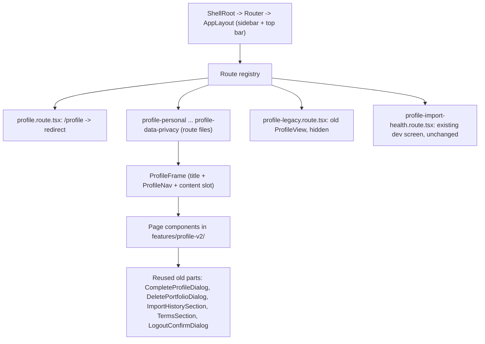

# Profile: architecture (extends the nav-shell architecture, draft v1)

**Status:** draft, 2026-10-23. Planning only. Document 6. Read with `2026-10-22-nav-shell-architecture.md` (shell structure, registry, layouts). The shell code does not exist yet on this branch (`frontend/src/shell/` is absent); this work waits for the shell PR (E2 A).

## 1. Where Profile sits



Profile uses the shell's `AppLayout` and route scope `none`. The sidebar's footer item "Profile" points at `/profile`. Nothing in the shell's layout, sidebar or scope code is edited by Profile.

## 2. Route files (all in `frontend/src/shell/routes/`)

| id | path | section | status | page |
|---|---|---|---|---|
| `profile` | `/profile` | footer 1 | live | redirect to `/profile/personal` |
| `profile-personal` | `/profile/personal` | null | live | `PersonalInfoPage` |
| `profile-family` | `/profile/family` | null | live | `FamilyPage` |
| `profile-connected-accounts` | `/profile/connected-accounts` | null | live | `ComingSoonPage` (copy: Connected Accounts) |
| `profile-settings` | `/profile/settings` | null | live | `SettingsPage` |
| `profile-settings-notifications` | `/profile/settings/notifications` | null | live | `ComingSoonPage` |
| `profile-settings-preferences` | `/profile/settings/preferences` | null | live | `ComingSoonPage` |
| `profile-settings-security` | `/profile/settings/security` | null | live | `ComingSoonPage` |
| `profile-settings-import-history` | `/profile/settings/import-history` | null | live | `ImportHistoryPage` |
| `profile-subscription` | `/profile/subscription` | null | live | `SubscriptionPage` |
| `profile-tax` | `/profile/tax` | null | live | `ComingSoonPage` |
| `profile-data-privacy` | `/profile/data-privacy` | null | live | `DataPrivacyPage` |
| `profile-legacy` | `/profile/legacy` | null | live | wrapper of the old `ProfileView` (hidden, A3 B); **deleted in the retirement task (L42)** |
| `profile-import-health` | `/profile/import-health` | null | live | existing, unchanged |

All have `layout: "app"` and `scope: "none"`. `section: null` keeps them out of the sidebar; only `profile` is a footer item. The contract currently reserves nine `/profile/:section` paths (personal, family, connected-accounts, notifications, preferences, security, subscription, tax, data-privacy); this design replaces `notifications`, `preferences` and `security` with children of `settings` and adds `import-history` and `legacy`. **That is a proposed change to contract v1.2 (O10 and the URL map); it has not been applied.** The exact wording is in the backend decisions proposal's contract appendix.

## 3. Frontend structure

```
frontend/src/features/profile-v2/
  ProfileFrame.tsx, ProfileNav.tsx, profileNav.ts
  pages/
    PersonalInfoPage.tsx, FamilyPage.tsx, SettingsPage.tsx,
    ImportHistoryPage.tsx, SubscriptionPage.tsx, DataPrivacyPage.tsx,
    ComingSoonPage.tsx
  components/
    HeaderCard.tsx, PersonalInfoCard.tsx, PanField.tsx, InitialsAvatar.tsx,
    FamilyStrip.tsx, FamilyTable.tsx, FamilyRowMenu.tsx, AddMemberDialog.tsx,
    ContactChangeDialog.tsx, DeleteAccountDialog.tsx, SettingsRows.tsx,
    SubscriptionCard.tsx, ConsentList.tsx, StoredDataNote.tsx, ComingSoonBlock.tsx
  lib/accessLevel.ts, accountType.ts, initialsOf.ts
```

Each page component calls `useAuth()` and the existing member and history loaders, renders inside `ProfileFrame`, and holds its own loading and error state. There is no Profile-wide store, so one page failing cannot affect another. Pages re-fetch on mount (no cross-page cache), which keeps the family list correct after an import deletion in Settings.

## 4. Backend structure

```
backend/app/services/auth/schemas.py              + MeResponse.created_at (Q2)
```

No new module, table, job or migration.

## 5. PAN

Always masked; the API already returns `pan_masked`. There is no reveal flow (L49).

## 6. Cross-cutting

- **Security:** PAN value lives only in component state; never in browser storage, URL, logs or analytics.
- **Mobile:** untouched; the mobile tree keeps the old `ProfileView`.
- **Existing gates:** authentication, onboarding, consent and pending-deletion gates run before the shell, as today; after account deletion succeeds the existing pending-deletion screen replaces the shell.
- **Legacy screen (L42):** the implementation plan ends with a task that deletes the old Profile (screen, test, legacy route, and the old family section and card) after you accept Profile v2. Reused parts stay. See the reuse-vs-new doc, "Retirement of the old Profile".

## 7. Architectural decisions proposed (for the owner; not recorded anywhere yet)

1. Profile pages are separate route files with a shared `ProfileFrame`, not nested routes in one component, so each page is lazy and owned by one file (matches the contract's one-file-per-page rule).
2. New code lives in `features/profile-v2/`; the old folder stays untouched.
3. Two small dialogs are duplicated rather than extracted (reuse-vs-new doc).
4. One new read endpoint; no schema change.

## 8. Risks

- The shell is not built yet; the route files assume the contract's `ShellRoute` type as written in v1.2.
- `CompleteProfileDialog` lives under `features/dashboard/members/`; importing across features is an existing pattern (the old `HouseholdMembersSection` does it), but a future move of that file would break an import.
- `useAuth()` method names used by the new dialogs must match what the shell wrapper passes `ProfileView` today (verification item 5 in the spec).

## 9. Added 23 Oct, later

- **Add statement** hands off to the shell's `/import?member=<id>` (focus layout) and Back returns to `/profile/family`. The Profile code never imports the import flow; it only navigates through `paths`.
- **Onboarding data** is read from `GET /auth/me` (`investor_type`, `primary_goals`) and written with `PATCH /auth/me`; no Profile endpoint is added.
