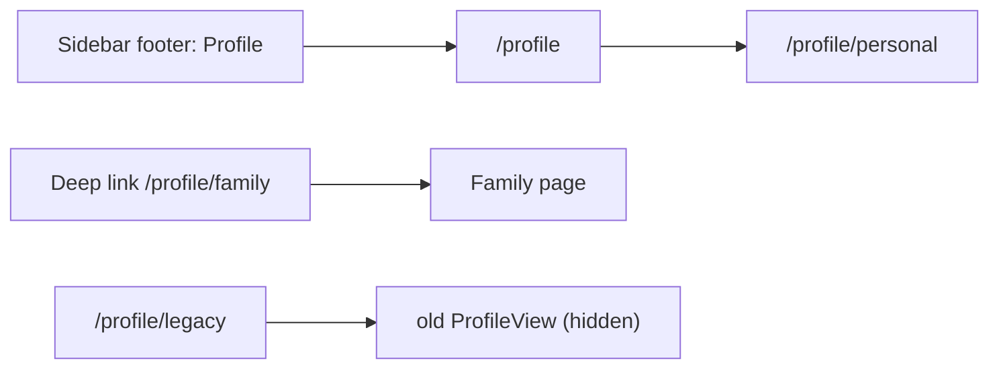
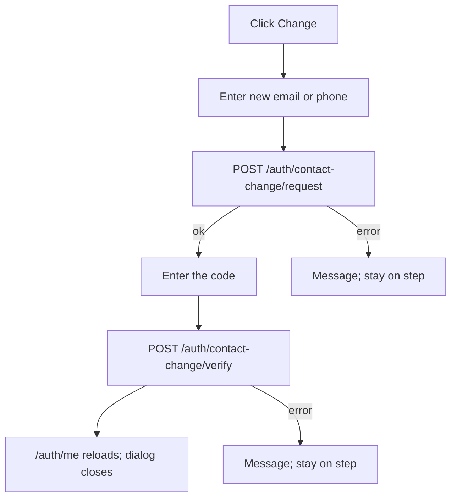
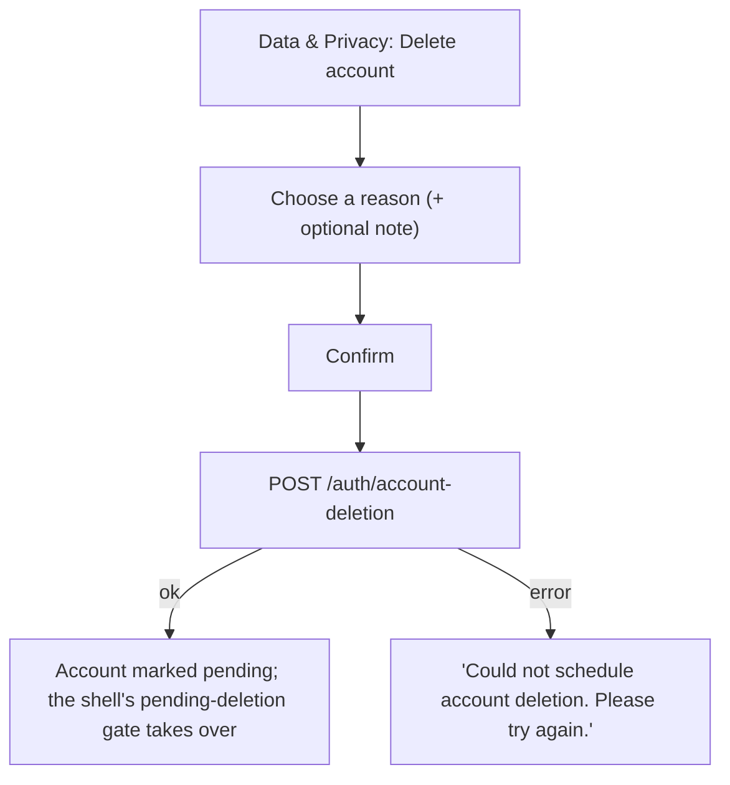
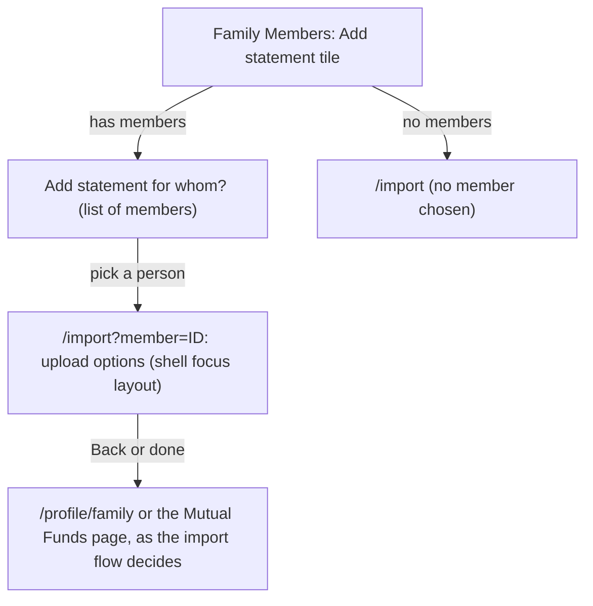
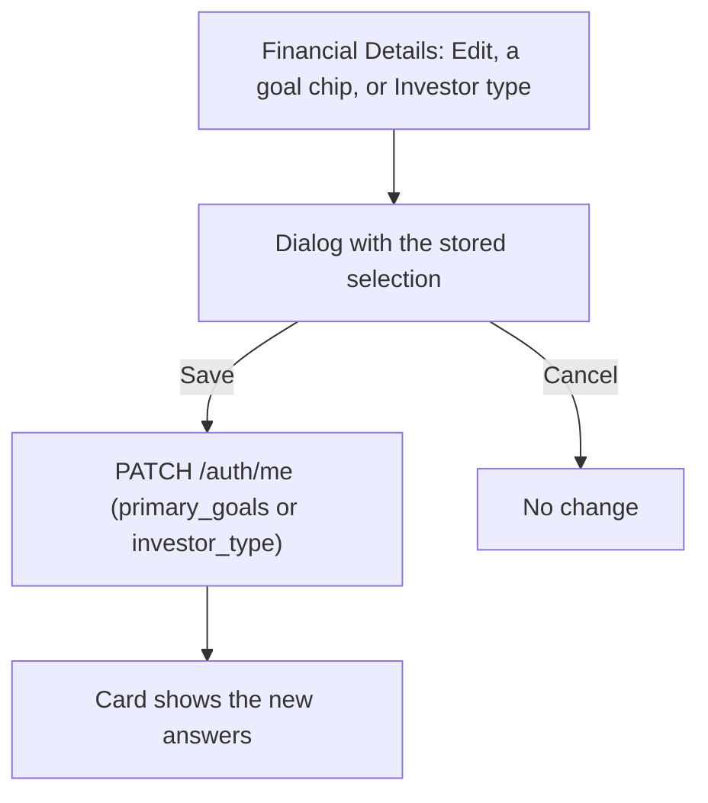

# Profile: user flows and request flows (draft v1)

**Status:** draft, 2026-10-23. Planning only. Document 8. Facts about existing calls verified in code on 23 Oct 2026.

## 1. Entering Profile

A deep link to any valid Profile path opens that page once the existing gates pass (authentication, onboarding, consent, pending-deletion).

## 2. Moving between sections

Click a left-list item: the URL changes, the content swaps, the list highlights the new item. Browser Back and Forward move through the pages visited. Settings stays highlighted on its four child pages; each child has a "Settings" back link.

## 3. PAN

Always masked; there is nothing to click (L49).

## 4. Change email or mobile (existing flow, new dialog)

Closing the dialog cancels any in-flight request's effect (the stale-request guard from the old dialog is kept).

## 5. Add a member and the other family actions

- **Add Member:** dialog (name, relationship, "other" label when relationship is other) -> `POST /household-members` -> list reloads. 409 (a self member exists) and 422 (invalid name) show messages.
- **Edit:** `CompleteProfileDialog` -> `PUT /household-members/{id}/profile`; possible duplicate and other-account prompts are the dialog's own.
- **Merge:** no standalone action (Q1). Merge happens only inside Edit's possible-duplicate prompt (`POST /household-members/{id}/merge-into/{target}`).
- **Delete all funds:** `DeletePortfolioDialog` -> `DELETE /household-members/{id}/portfolio` (option to remove the member) -> list reloads. The existing queue work after a delete (cache clear, snapshot and Analytics refresh) is unchanged; Profile does not start any compute of its own.

## 6. Import History (Settings)

Settings -> Import History -> the existing list. Delete an import -> existing delete call with its confirmation -> the list reloads. The same background work as today follows; Profile adds none.

## 7. Delete account

The 30-day grace period and the reactivate flow are unchanged.

## 8. Logout

Click Logout in the list footer -> confirmation dialog -> `logout()` from `useAuth()` -> the existing authentication screen.

## 9. What is computed when

Nothing on Profile computes portfolio data. Page loads make small reads (`/auth/me`, `/household-members`, import history, `/legal/consents/me`, `/legal/documents`). The only write paths are the existing ones above.

## 10. Added 23 Oct, later

**Add statement**

**Edit goals or investor type**

