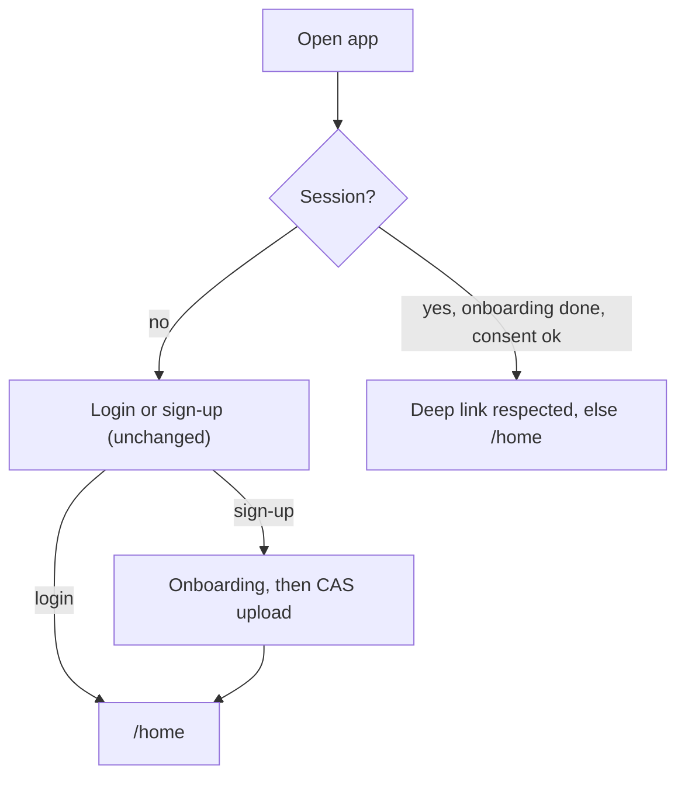
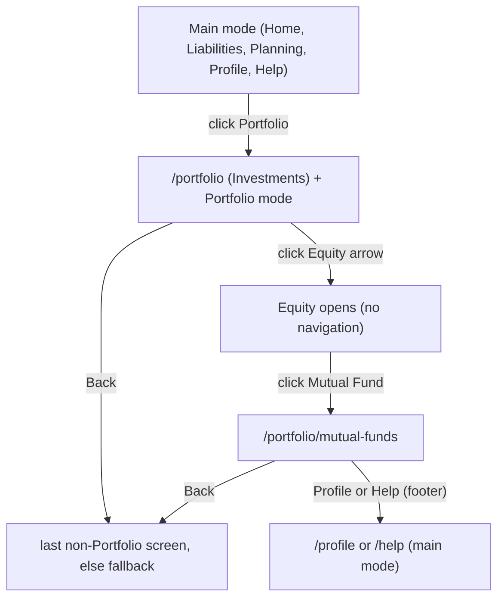
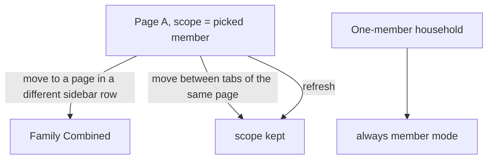
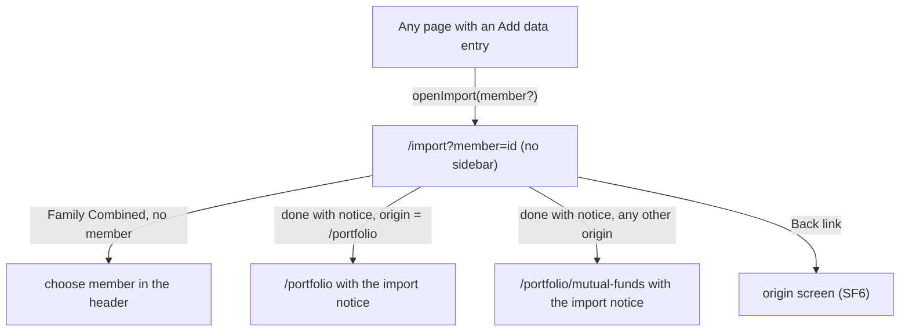

# Navigation shell: user flows and navigation flows (draft v1)

**Status:** draft, 2026-10-23. Doc 8. Diagrams are Mermaid. Home contents are a separate document set. Decisions: L35, N2 to N13, B1 follow-ups.

## 1. Landing

Auth, onboarding, re-consent, pending deletion and the maintenance banner stay outside the shell, unchanged; the shell mounts only for a ready user. **Decided (SF1 answer B, 23 Oct):** `/` and the post-login landing go to `/home`, which shows the shared Coming soon page until the Home PR sets `home` to live. Home is built right after the shell and everything is staged together at the end, after all pages from the PDF exist, so no user lands on the placeholder in staging. During development the Portfolio row is greyed until `/portfolio` ships; developers reach `/portfolio/mutual-funds` by URL.

## 2. Portfolio mode enter and exit

Rules: mode follows the URL. Entering Portfolio from a screen outside Portfolio remembers that screen for Back (live, normal layout only). Opening a page in a different sidebar row resets the scope to Family Combined; moving between the tabs of one page keeps the pick.

## 3. Back

`Back` goes to the stored path. Not stored (deep link straight into `/portfolio/...`, or after a refresh in a new tab) goes to the fallback. A stored path that is now a placeholder or `/import` is never used. A refresh keeps the stored path (`sessionStorage`).

## 4. Equity group

Closed by default on first visit to `/portfolio`. Opens on its own when the URL is one of its four children. Clicking the label or the arrow toggles it; the choice is remembered for the session. A typed or bookmarked `/portfolio/equity` redirects to `/portfolio/mutual-funds`.

## 5. Scope

## 6. Import (focus layout)

The origin path is passed in router state and used for both the Back link and import completion; the CAS resume step is cleared on leaving, as today. **v1.3 (23 Oct):** completion is origin-aware only for the Portfolio home page — opening import from `/portfolio` returns to `/portfolio`. Every other origin (Dashboard, Analytics, the temporary top-bar button) keeps the v1.2 behaviour and always lands on `/portfolio/mutual-funds`, matching `MainDashboardFlow`'s existing "switch back to the Dashboard tab" behaviour for those origins.

## 7. Deep links, refresh, back and forward

Every path in the URL map resolves directly (hosting falls back to `index.html`). Browser back and forward move through router history; the old `unifolioTab` history-state is retired. Unknown paths show not-found. Print and legal pages and mobile never enter the router.

## 8. Placeholder pages

Sidebar rows for unbuilt pages are greyed with a "Coming soon" tooltip and are not links. A typed URL for one shows the shared Coming soon page with a link to Investments (C4). When an owner replaces a placeholder and sets `status: "live"`, every link to it turns on with no other edit.

## 9. Risks in the flows

Landing on the Home placeholder (SF1) is accepted because staging waits for every page. The temporary tab strip (SF2) and the temporary "+ Add data" button (SF3) must be removed with a contract change note when the Mutual Funds menu and the Investments page ship; the TDD has a test for each so their removal is deliberate.
