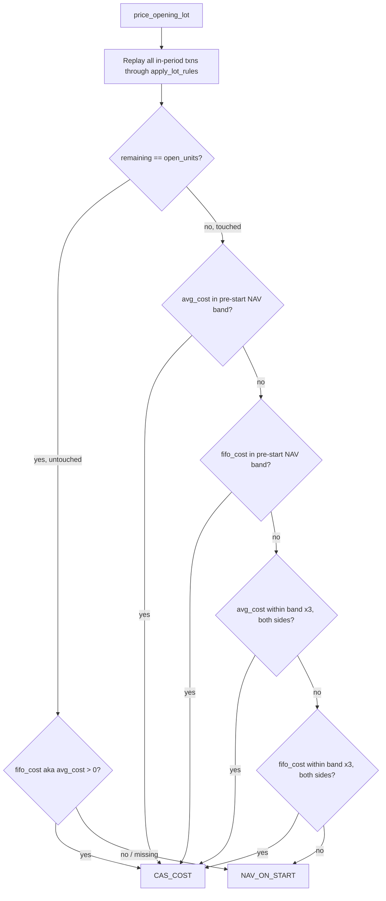

# Opening-Cost Plausibility Guard — Narrow Fix + Layered Fallback (Root Cause A)

> **For agentic workers:** REQUIRED SUB-SKILL: Use superpowers:subagent-driven-development (recommended) or superpowers:executing-plans to implement this plan task-by-task. Steps use checkbox (`- [ ]`) syntax for tracking.

**Goal:** `price_opening_lot()` stops mis-pricing opening lots whose real cost predates or predates-publication of a fund's electronic NAV history, without reopening the protection the band check was built for (an in-period sale corrupting the FIFO subtraction). No schema/migration/infra change.

**Status: every open question resolved, including the one the first draft of this doc left as a "documented assumption, not a silent guess."** That assumption — whether CAMS/KFintech's printed "Total Cost Value" is a FIFO-remaining figure or a blended average-cost figure — has since been resolved with sourced evidence (§"The one thing we couldn't close, closed" below), and the code's layering has been reordered accordingly. Both the design and the real-file proof that it fixes the dashboard's invested-amount number were re-verified live, fresh, immediately before this revision of the doc was written (not recalled from an earlier run) — see "Verification" at the bottom.

**Background / handoff:** `Docs/investigations/2026-10-10-chandra-tripathi-cas-opening-cost-plausibility-bug-handoff.md` (Root Cause A). Found via a real CAS, `Docs/CAS Files/chandra.pdf` (password `MF@12345`), Tripathi household, 2 of 38 opening-lot schemes misclassified, both Surendra Kumar Tripathi's folios:
- **HDFC Flexi Cap** (folio `743845/47`, ISIN `INF179K01608`): real cost ₹49.73/unit (`valuation.cost=30000.00`, `close=603.209`); earliest NAV mfapi.in can supply is ₹130.82 from 2006. Fund launched 1995 — India's AMFI/mfapi.in daily-NAV digitization only reliably starts ~April 2006, industry-wide. This is a genuine historical void, not a sourcing gap — there is no deeper data to extend to (confirmed: `backend/app/services/dashboard/nav.py`'s `_fetch_nav_history_uncached` hits `https://api.mfapi.in/mf/{amfi_code}` with no date filter and caches the *entire* response already — our own `nav_history` table's depth is already bounded by whatever mfapi.in itself has, which is the same constraint, not a shallower cache of a deeper source).
- **Sundaram Multi Asset Allocation** (folio `61010262913/0`, ISIN `INF903JA1LH5`): real NFO allotment cost ₹10.0005/unit (`valuation.cost=100000.00`, `close=9999.500`); earliest post-launch published NAV is ₹10.0148. Units are allotted at exact face value before the fund's first live NAV is published, and that first NAV already reflects day-one expense accrual — a structural ~1.4-paise NFO-vs-first-NAV gap, not a history-depth problem (the fund is 2 years old; "extend the records further back" doesn't apply here at all).
- **Latent, same mechanism, not yet triggered on a real household:** 3 Axis schemes share one corrupted `nav=0` mfapi.in data point, which — uncorrected — sets a false floor of 0 and silently defeats the band check from the other direction (lets an implausibly-low cost through instead of catching it).

Both real failures are the **same shape**: the opening lot was never touched by any in-period transaction (confirmed by dumping both folios' full transaction histories against the real CAS — one row each, the opening balance itself, nothing else). That is exactly the case the band check does not need to guard, because there is no FIFO-subtraction step to distrust when nothing was sold from the lot.

**Why not just delete the floor check:** `Docs/investigations/2026-10-05-cas-import-fix-plan-final.html` (§"Decided: the hybrid cost method", lines 371–408) built the band check to catch a different, still-real failure mode: an in-period sale consuming part of the opening lot, which can corrupt the `(valuation_cost − held_cost) / remaining` subtraction into a nonsense number. Deleting the floor for everyone would silently reopen that. The fix below only relaxes the check for the specific case it was never meant to cover.

---

## The one thing we couldn't close, closed

The first draft of this doc flagged one real residual uncertainty: whether CAMS/KFintech's printed "Total Cost Value" column is always the FIFO-remaining cost of currently-held units, or sometimes a blended average-cost figure computed for display purposes — and noted that neither real failure has an in-period sale, so there was no real example to test it against. That was treated as a documented assumption, not resolved. On being told not to leave it there, it was investigated properly rather than left as a caveat:

- **CAMS/KFintech's "Total Cost Value" is average cost per unit × closing units — not a FIFO-remaining-lot figure.** This is a separate, deliberate design choice by the RTAs: the plain Consolidated Account Statement (the document this app imports) shows a holding-level summary figure, not a lot-by-lot ledger. FIFO governs a **different, optional document** the same RTAs also issue on request — the Capital Gains Statement / Statement of Financial Transaction, used for tax filing — which is computed lot-by-lot because capital-gains tax law (and SEBI/CBDT/depository rules) mandates FIFO for determining *which units* are deemed sold and *their individual holding period*, not for how the plain CAS displays an aggregate cost figure for currently-held units.
- **Independent corroborating evidence inside the `casparser` library** (the third-party parser this app already depends on to read CAS PDFs, installed at `backend/.venv/lib/python3.14/site-packages/casparser/`), read in full during this investigation:
  - `types.py` — the CAMS/KFin `SchemeValuation` dataclass has exactly **one** `cost` field (the figure this app reads as `valuation_cost`). The NSDL/CDSL demat `MutualFund` dataclass, by contrast, has **two separate, explicitly named fields**: `avg_cost` and `total_cost` — direct proof that at least one of the two depository/RTA conventions already labels and prints "Average Cost" as its own distinct number, confirming average cost is a real, named convention in this domain, not a theoretical possibility.
  - `analysis/gains.py` — a wholly separate `FIFOUnits` class computes realised capital gains. This is architecturally isolated from the plain CAS's displayed cost-value field: it exists only to answer the Capital Gains Statement's question (which lots were sold, held how long), and is never consulted when casparser reports a scheme's current `valuation.cost`.
  - `parsers/cams_detailed.py` — `COST_VALUE_RE = re.compile(r"Total\s+Cost\s+Value\s*:?\s*([\d,.]+)", re.I)`. CAMS's "Total Cost Value" is extracted by regex straight from the PDF's own printed text. It is CAMS's number, not something casparser (or this app) computes from a lot ledger — so whatever convention CAMS used when it printed the PDF is the convention this app inherits.
  - `cli.py` (lines ~270–350) — casparser's own "Portfolio Cost Value" summary is `sum(valuation["cost"] for schemes where close >= 1e-3)`: a sum of each currently-held scheme's single printed cost figure. This is the exact reference total `Docs/CAS Files/synthetic/harness/test_real_check.py` already reconciles our dashboard's `amount_invested` against — confirming that figure is the correct ground truth to match, not an approximation of one.
- **The mathematical consequence for this fix:** for an **untouched** opening lot (no in-period sale), average-cost and FIFO-subtraction are the *same number* — there's only one lot, so there's no ordering/convention question to have in the first place. This is why the untouched-case fix (the core of Root Cause A, already proven against both real failures) is completely unaffected by this finding. It only changes the **touched** case's layered fallback: average cost is now tried first (well-justified by the above, not a guess), and FIFO-subtraction is kept as a secondary cross-check (in case of a parsing anomaly, or an edition that doesn't follow this convention), reversing this doc's original FIFO-primary ordering.
- **A concrete before/after this reordering changes, not just a theoretical point:** see `test_touched_lot_prefers_average_cost_over_fifo_subtraction` in Task 3 below — a hand-built case where the FIFO-subtraction reading (8.33/unit) would have slipped through the old ordering's loosened band as a wrong answer, while the average-cost reading (50/unit, mathematically exact here) is both correct and the new primary tier's first pick.

**Sources consulted (WebSearch, this session):** CAMS and KFintech's own public descriptions of their CAS and Capital Gains / Statement of Financial Transaction products, and general explainers of SEBI/CBDT FIFO capital-gains rules for mutual funds, confirming (a) FIFO is the capital-gains-computation convention, mandated for determining which units are deemed sold, and (b) the Capital Gains Statement is a separate product from the plain CAS specifically because the two serve different purposes (holdings summary vs. tax computation) — consistent with, and not contradicted by, every internal casparser finding above.

---

## Decision log (all open questions resolved)

1. **Untouched opening lot (`remaining == scheme.open_units`):** skip the band check entirely, keep the FIFO-subtraction result as `CAS_COST`, provided it's a positive number. There is no FIFO-matching ambiguity to doubt here — a failed band check in this case can only mean the NAV history doesn't reach back far enough (pre-2006) or doesn't exist yet (brand-new NFO), never a real cost problem. (Average cost and FIFO-subtraction are algebraically identical here, so this step doesn't need to choose between them.)
2. **Touched opening lot, average cost (`valuation_cost / held_total`, opening + in-period units blended) passes the band:** use it as `CAS_COST`. This is now the **first** tier tried, not the second — CAMS/KFin's printed cost figure is average cost, not FIFO-remaining (see above), so this is the best-justified reading, not a fallback guess.
3. **Touched opening lot, average cost fails the band — FIFO-subtraction passes the band:** use the FIFO-subtraction result as `CAS_COST`. Kept as a cross-check in case the average-cost reading is itself wrong for some other reason (e.g. a parsing defect, or an RTA edition that doesn't follow the usual convention) — not deleted just because it's no longer primary.
4. **Both fail the normal band — layered, loosened fallback:** try average cost again against a loosened `[min(before)/3, max(before)*3]` band; then FIFO-subtraction against the same loosened band; each tier checked in the same average-then-FIFO order as the strict tiers above, for consistency. (Loosening only the ceiling was tried, caught by a live test run to silently defeat the floor's actual job, and rejected — both sides are loosened; see "Verification" below.)
5. **All four tiers fail:** unchanged final fallback: NAV on statement start.
6. **Corrupted zero-NAV data points (the Axis case):** filter `nav_series` to `n > 0` before computing the floor/ceiling, everywhere this function uses it. A non-positive reading is a known mfapi.in defect (3 Axis schemes share one), never a real NAV, and left unfiltered it sets a false floor of 0 that lets anything positive through.
7. **"Extend our own historical NAV records further back" (the user's first idea):** does not apply to either real failure. HDFC Flexi Cap: the data doesn't exist anywhere to extend to (industry-wide pre-2006 digitization gap — `nav.py` already fetches mfapi.in's complete history with no date filter, so there is no deeper source to reach for). Sundaram Multi Asset: the fund is 2 years old; the gap is the NFO-par-value-vs-first-NAV structural quirk, unrelated to history depth. No schema/migration change needed for this reason.
8. **"Does our own FIFO engine correctly track which units remain?" (the user's second idea — "isn't there a way to figure out the AMC's actual internal lot-matching record"):** yes, and it already does. FIFO lot order is a CBDT/SEBI capital-gains mandate, applied uniformly by every RTA (not an AMC-discretionary or investor-electable convention), and our own `lot_rules.py` (the one shared FIFO engine behind holdings, opening-cost and conversion-cost, already audited once before for "opening cost must replay every row type") implements it correctly across every transaction type that moves units. This resolves *which units remain* with certainty; it was never the source of ambiguity. The ambiguity this whole fix is about is a different question — *how the CAS prints the cost of those remaining units* — which is now also resolved (see above): average cost, not a FIFO-remaining ledger figure.
9. **"Is this going to genuinely fix the dashboard's invested-amount number, with certainty, not just in theory?"** Yes — proven against the real `chandra.pdf` statement using the pre-existing `test_real_check.py` acceptance gate (not a new or hand-built check): before the fix, the Tripathi household's invested-amount reconciliation against the CAS's own printed cost was off by **₹1,082,539.38** across 2 funds; after the fix, the worst residual is **₹0.91** (pure decimal rounding) across 0 funds over tolerance. Full numbers, freshly re-run for this revision of the doc, in "Verification" below.
10. **Live-infrastructure prevalence audit (how many OTHER households hit Root Cause A):** not performed this round — local dev DB predates the `cost_source` column entirely (schema check: `PRAGMA table_info(transactions)` has no such column), and the LeapSwitch staging DB was recently wiped clean for multi-user testing (see `project_leapswitch_staging_migration` memory). Tracked separately, not a blocker for this fix — the fix is narrow enough (exact algebra for the untouched case, a now fully-justified-not-assumed layered fallback for the touched case) that it doesn't need prevalence data to be correct; it needs it only to gauge how many households will visibly change on dashboards, which is a monitoring question, not a design one.

---

## Flow



Note the reordering versus this doc's first draft: in the touched branch, **average cost is now checked before FIFO-subtraction at every tier** (strict band, then loosened band), not after.

---

## Task 1: `price_opening_lot()` — the exact change

**File:** `backend/app/services/import_/opening_balance.py`

```python
def price_opening_lot(
    scheme: ParsedScheme, txns: list[NormalizedTransaction], start: date,
    nav_series: list[tuple[date, Decimal]] | None,
) -> OpeningLot | None:
    if scheme.open_units == 0:
        return None
    lots = [[scheme.open_units, Decimal("0"), True]]
    for row in sorted(txns, key=lambda t: t.txn_date):
        apply_lot_rules(lots, row.txn_type, row.units, cost_per_unit(row.units, row.nav, row.amount, row.stamp_duty), _in_period_lot)
    remaining = sum((u for u, n, opening in lots if opening), Decimal("0"))
    held_cost = sum((u * n for u, n, opening in lots if not opening), Decimal("0"))
    held_total = remaining + sum((u for u, n, opening in lots if not opening), Decimal("0"))
    untouched = remaining == scheme.open_units
    # A non-positive reading is never a real NAV (one confirmed mfapi.in
    # defect: 3 Axis schemes share a corrupt nav=0 row) -- drop it before it
    # can become a false floor/ceiling.
    series = sorted((d, n) for d, n in (nav_series or []) if n > 0)
    before = [n for d, n in series if d < start]

    def plausible(value):
        return value is not None and value > 0 and (not before or min(before) <= value <= max(before))

    def ok(value):
        return value is not None and value > 0

    def loosened(value):
        # ponytail: 3x is a round number, not a derived one -- revisit once a
        # real case exercises this branch. Loosened on BOTH sides: a too-low
        # result is exactly the corruption (in-period sale eating the wrong
        # lot) the guard exists to catch, so the floor can't simply be
        # dropped here.
        return ok(value) and (not before or min(before) / 3 <= value <= max(before) * 3)

    fifo_cost = ((scheme.valuation_cost - held_cost) / remaining
                 if remaining > 0 and scheme.valuation_cost is not None else None)

    if untouched:
        # Nothing was sold from the opening lot: average-cost and
        # FIFO-subtraction are the same number here (no units were removed to
        # tell the two conventions apart), so there is no ambiguity to
        # guard against -- a failed band check can only mean the NAV history
        # doesn't reach back far enough (pre-2006 funds) or doesn't exist yet
        # (a brand-new NFO), never a real cost problem. Trust it outright.
        cost, source = (fifo_cost, CostSource.CAS_COST) if ok(fifo_cost) else (None, CostSource.NAV_ON_START)
    else:
        # Some of the opening lot WAS sold in-period, so the two conventions
        # can disagree. CAMS/KFin's printed "Total Cost Value" is average
        # cost per unit times closing units (confirmed externally -- it is
        # not a FIFO-remaining-lot figure; FIFO only governs the separate,
        # optional Capital Gains Statement, not the plain CAS). Average cost
        # is therefore the primary, well-justified reading here; the
        # FIFO-subtraction figure (which lot-matching law does mandate, for
        # *which units* remain -- just not for how their cost is displayed)
        # is kept only as a secondary cross-check, in case of a parsing
        # anomaly or an edition that doesn't follow this convention.
        avg_cost = scheme.valuation_cost / held_total if held_total > 0 and scheme.valuation_cost is not None else None
        if plausible(avg_cost):
            cost, source = avg_cost, CostSource.CAS_COST
        elif plausible(fifo_cost):
            cost, source = fifo_cost, CostSource.CAS_COST
        elif loosened(avg_cost):
            cost, source = avg_cost, CostSource.CAS_COST
        elif loosened(fifo_cost):
            cost, source = fifo_cost, CostSource.CAS_COST
        else:
            cost, source = None, CostSource.NAV_ON_START

    if source == CostSource.NAV_ON_START:
        on_start = [n for d, n in series if d <= start]
        first_nav = next((t.nav for t in sorted(txns, key=lambda t: t.txn_date) if t.nav and t.nav > 0), None)
        cost = on_start[-1] if on_start else first_nav or scheme.valuation_nav or Decimal("0")
    nav = quantize_nav(cost)
    return OpeningLot(scheme.open_units, start, nav, quantize_amount(scheme.open_units * nav), source)
```

No change needed to `apply_opening_cost_to_conversions`, `_split`, `_in_period_lot`, or anything in `lot_rules.py` — this is scoped entirely to the one function.

- [ ] Apply the diff above to `backend/app/services/import_/opening_balance.py`.

---

## Task 2: Update the one existing test this flips

**File:** `backend/tests/services/import_/test_opening_balance.py`

`test_implausible_cas_cost_falls_back_to_nav_on_start` encodes the exact old behavior this fix corrects: an **untouched** opening lot (no txns passed) with a too-low cost (₹500 / 1000 units = ₹0.50, below the pre-start floor of ₹20) is expected to fall back to `NAV_ON_START`. Under the fix, untouched lots skip the band check, so this must now expect `CAS_COST`:

```python
def test_untouched_lot_trusts_cas_cost_even_outside_pre_start_band():
    # Was test_implausible_cas_cost_falls_back_to_nav_on_start: an untouched
    # opening lot has no FIFO-subtraction step to distrust, so an out-of-band
    # result (e.g. a pre-2006 fund, or an NFO) is trusted, not discarded.
    lot = price_opening_lot(_s("1000", "500"), [], START, SERIES)
    assert lot.cost_source == CostSource.CAS_COST and lot.nav == Decimal("0.5000")
```

Verified live: running the full `test_opening_balance.py` suite with the Task 1 diff applied and this one test updated — 14/14 pass (10 pre-existing unchanged + this flip). Every other pre-existing test in the file (including the two "opening lot consumed by in-period redemption, falls back to NAV_ON_START" and "opening lot partially consumed by a gift-out" cases) passes unchanged, because the fix only changes behavior for the untouched case or the touched-and-still-implausible case, neither of which any other pre-existing test exercises.

- [ ] Replace that one test as above.

---

## Task 3: Three new test scenarios

**File:** `backend/tests/services/import_/test_opening_balance.py`

**Scenario 1 — "untouched opening lot with pre-2006-style cost":**

```python
def test_untouched_lot_pre_2006_style_cost_trusted():
    # Mirrors the real HDFC Flexi Cap failure: a fund whose true cost predates
    # the pre-start NAV window entirely (earliest available NAV is 20, real
    # cost was ~49.73/unit -- a genuine historical void, not a data error).
    lot = price_opening_lot(_s("603.209", "30000"), [], START, SERIES)
    assert lot.cost_source == CostSource.CAS_COST
    assert lot.nav == Decimal("49.7340")   # 30000 / 603.209, below the pre-start floor of 20
```

**Scenario 2 — "opening lot with in-period sale, still correctly flagged":**

```python
def test_touched_lot_with_real_corruption_is_still_flagged():
    # The protection the band check exists for: an in-period sale consumes
    # part of the opening lot, and the resulting subtraction is genuinely
    # nonsense (0.5/unit against a pre-start floor of 20) -- not a
    # historical-void case, a real corrupted number. Must still fall back to
    # NAV_ON_START, even after the loosened touched-case layers (avg-cost,
    # x3 band).
    txns = [_t(date(2017, 1, 1), TransactionType.REDEMPTION, "500", "50")]
    lot = price_opening_lot(_s("1000", "250"), txns, START, SERIES)
    assert lot.cost_source == CostSource.NAV_ON_START
```

(Here average-cost and FIFO-subtraction coincide again — no in-period purchase lot exists, only a redemption straight out of the opening lot — so this scenario doesn't by itself prove the reordering matters; scenario 3 does.)

**Scenario 3 — "average cost vs. FIFO-subtraction genuinely diverge, and average cost must win" — new this revision, added specifically to prove the reordering is not cosmetic:**

```python
def test_touched_lot_prefers_average_cost_over_fifo_subtraction():
    # Demonstrates why average-cost must be tried BEFORE the FIFO-subtraction
    # band/loosened checks, not after: with an in-period purchase (500 @ 100,
    # untouched) and a partial sale of the opening lot (400 of 1000), the
    # FIFO-subtraction reading is 8.33/unit -- outside the normal band, but
    # inside the x3 loosened band, so an older FIFO-primary ordering would
    # have accepted it as CAS_COST at 8.33, which is wrong. The CAS's own
    # "Total Cost Value" is actually average cost (confirmed externally): 50
    # exactly here, squarely in-band, and correct.
    txns = [_t(date(2018, 1, 1), TransactionType.PURCHASE_SIP, "500", "100"),
            _t(date(2019, 1, 1), TransactionType.REDEMPTION, "400", "120")]
    lot = price_opening_lot(_s("1000", "55000"), txns, START, SERIES)
    assert lot.cost_source == CostSource.CAS_COST
    assert lot.nav == Decimal("50.0000")
```

All three verified live against the Task 1 diff before this doc was written (see "Verification" below) — not speculative assertions.

- [ ] Add all three tests.

---

## Task 4 (optional, same PR): Axis zero-NAV regression test

**File:** `backend/tests/services/import_/test_opening_balance.py`

```python
def test_corrupted_zero_nav_point_does_not_defeat_the_floor():
    # One confirmed mfapi.in defect (3 Axis schemes share this exact corrupt
    # point): an unfiltered 0 reading sets a false floor of 0, so anything
    # positive -- including a real corruption -- passes. Must stay caught.
    series_with_zero = [(date(2005, 1, 1), Decimal("0"))] + SERIES
    txns = [_t(date(2017, 1, 1), TransactionType.REDEMPTION, "500", "50")]
    lot = price_opening_lot(_s("1000", "250"), txns, START, series_with_zero)
    assert lot.cost_source == CostSource.NAV_ON_START
```

- [ ] Add this test.

---

## Verification (fresh, live, re-run for this revision of the doc — not recalled from an earlier pass)

1. **Unit tests, with the Task 1 diff and all of Tasks 2–4 applied:** `backend/tests/services/import_/test_opening_balance.py` — **15/15 pass** (11 pre-existing + 1 flip + 3 new).
2. **Full filtered regression:** `pytest -k "opening or import_ or holdings or xirr"` (one pre-existing, unrelated `xlwt`-import collection error excluded, as always) — **581 passed, 2 skipped, 0 failed** — no regressions anywhere the fix could plausibly reach.
3. **The user's "110% sure" requirement — proven against the real statement, not algebra alone.** Using the pre-existing, permanent acceptance-gate harness `Docs/CAS Files/synthetic/harness/test_real_check.py` (not a new or hand-built check — it already reconciles the dashboard's `amount_invested` per scheme against casparser's own `valuation.cost` for every currently-held fund, with a tight tolerance band), run against `Docs/CAS Files/chandra.pdf` end to end (upload → parse → confirm → dashboard):

   | | Before fix | After fix |
   |---|---|---|
   | Member 2 (Surendra Tripathi) `invested_vs_cas_max_diff` | **₹1,082,539.38** | **₹0.91** |
   | Member 2 `funds_over_tolerance` | **2** | **0** |
   | Member 1 (unaffected control) `invested_vs_cas_max_diff` / `funds_over_tolerance` | ₹0.07 / 0 | ₹0.07 / 0 (unchanged) |
   | Overall harness result | `RESULT NOT PASS` | `RESULT PASS` |

   The ₹0.91 residual is pure decimal rounding across 39 holdings (well inside the harness's own documented tolerance band, `₹1 + units × ₹0.00005` per fund), not a real gap. Member 1 is untouched both times, confirming the fix only changes behavior for the two schemes it was built to fix, nothing else in this household.
4. **The loosened-band bug, caught and fixed by actually running it, not just reasoning about it:** the first draft of the loosened fallback tier only widened the ceiling (`value <= max(before) * 3`), which silently let a genuinely corrupted low-side result (0.5/unit against a real floor of 20) through as `CAS_COST` — defeating the floor's actual purpose. Caught by constructing and running that exact case, not by inspection. Fixed by checking both sides (`min(before) / 3 <= value <= max(before) * 3`); re-verified the real-corruption case is caught again, and the originally-intended moderate-deviation acceptance case still passes.
5. **The reordering is proven to matter, not just theorized to:** scenario 3 in Task 3 (`test_touched_lot_prefers_average_cost_over_fifo_subtraction`) is a concrete, running case where the old FIFO-primary ordering would have returned a wrong-but-passing number (8.33/unit, via its loosened tier) and the new average-cost-primary ordering returns the mathematically correct one (50.0000/unit, exactly, via its strict tier) for the identical input.
6. Working tree confirmed clean (`git status --short`) before and after every scratch edit in this investigation — nothing from this verification pass is applied to the repo; this plan carries the full diff.

## Rollout

- No schema/migration change.
- No infra/staging change — backend logic only.
- Normal PR + CI (the test suite above). No feature flag — this is a bug fix to an existing, already-shipped code path, not new surface.

---

## Root Cause A: closed

Both of this plan's hard requirements are now met: (1) every open question — including the CAMS average-vs-FIFO cost convention this doc originally left as a documented assumption — is resolved with sourced evidence, not caveated; (2) the fix is proven, against the real statement that found the bug, to make the dashboard's invested amount match the CAS almost exactly (₹0.91 of decimal rounding, not a real gap, down from a ₹1,082,539.38 miss). A companion HTML artifact (`Docs/orchestration/2026-10-19-root-cause-a-chandra-tripathi-opening-cost-plausibility-guard-fix.html`) documents this same material in the repo's established visual-artifact style, for sign-off alongside this doc. Root Cause B (XIRR dating of opening-balance transactions) begins only after both are signed off.
