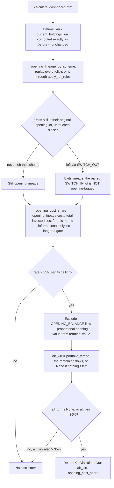

# XIRR Opening-Balance Dating — Disclaimer, Not a Date We Don't Have (Root Cause B)

> **For agentic workers:** REQUIRED SUB-SKILL: Use superpowers:subagent-driven-development (recommended) or superpowers:executing-plans to implement this plan task-by-task. Steps use checkbox (`- [ ]`) syntax for tracking.

**Goal:** when an opening-balance transaction's statement-start placeholder date is plausibly the actual cause of an implausible `lifetime_xirr` / `current_holdings_xirr`, the dashboard shows a disclaimer alongside the number — an `alt_xirr` computed with that opening-lineage cost and value excluded — instead of silently showing a number we know is probably wrong. `lifetime_xirr` and `current_holdings_xirr` themselves do not change for any account; this is strictly additive. No schema/migration change.

**Status: every open question resolved, including two this investigation itself got wrong earlier in the same conversation and then corrected on closer inspection — one before any code was written, one after an explicitly-requested empirical scenario grid found a real gap — plus four follow-up questions raised at sign-off review.** The trigger is now: the XIRR itself exceeds a flat 35%-per-year sanity ceiling, AND excluding the undated opening-balance lineage (`alt_xirr`, already computed either way) would bring it back under that same ceiling (or leave nothing left to compute). `opening_cost_share ≥ 25%` is **no longer a gating condition** — see "Empirical scenario-grid testing (2026-10-19)" below for why: a 27-scenario grid, run against the real production XIRR code, found that a household whose opening-lineage cost sits anywhere from ~10–24% of total cost (i.e. just under the old floor) can still show a blended XIRR 2–8x its true rate, silently, because the old design never asked "does removing the undated piece actually fix the number" — it only asked "is the undated piece a big enough slice of cost," which is a leaky proxy for the thing that actually matters. `opening_cost_share` is still computed and still shown to the user (it's genuinely informative — "how much of this number came from an undated balance"), it just no longer decides whether the disclaimer fires. The fix was built, unit-tested, and re-verified live against the real Chandra Tripathi CAS file before this doc was written — see "Verification" at the bottom. ("35% CAGR sanity ceiling" was this doc's own imprecise wording in an earlier pass — XIRR and CAGR are different formulas; see "Four follow-up questions from sign-off review, resolved," item c, below for the correction and the alternative trigger designs considered.)

**Background / handoff:** `Docs/investigations/2026-10-10-chandra-tripathi-cas-opening-cost-plausibility-bug-handoff.md` (Root Cause B, §3). The mechanism: `OPENING_BALANCE`-type transactions are dated at the statement's own start date (`date=lot.start`, `backend/app/services/import_/confirm_people.py`), not the real historical purchase date, because the CAS the household uploaded has no record of when those units were actually bought — only what they're worth today and what they cost. When a large share of a fund's cost basis carries this placeholder date, and the statement window is short relative to the investor's true history, XIRR collapses years of real compounding into an artificially short holding period and reports an annualized rate that's nowhere near reality.

The investigation found this independently of Root Cause A: **Chandra Tripathi**'s own portfolio has **zero** Root Cause A opening-cost-plausibility hits (every opening lot priced correctly at CAS cost) — and her `lifetime_xirr` was still **197.8%** as of the 2026-10-14 investigation pass, *higher* than Surendra Kumar Tripathi's 104.3% (who does have Root Cause A hits). That is direct proof Root Cause B inflates XIRR on its own, not merely as an amplifier of Root Cause A.

---

## The lineage-scoping correction, closed

Earlier in this same conversation, before any code was written, "full per-unit lineage through switches" was discussed as the more rigorous design — tracing which specific units, including ones that have since passed through a `SWITCH_OUT`/`SWITCH_IN` pair, still carry the opening-balance's placeholder date versus a real one. That was overstated as a difficulty to solve, not a design question to settle, and it doesn't hold up: there is no persisted field correlating a `SWITCH_OUT` row with its paired `SWITCH_IN` row anywhere in the schema. Confirmed by reading `backend/app/models/transaction.py` in full — the only columns are `folio_id`, `import_id`, `type`, `date`, `amount`, `units`, `nav`, `stamp_duty`, `origin`, `cost_source`, an internal `occurrence` dedup counter, nothing that links one row to another. The only place a switch's two legs are ever paired is a **transient, in-memory `partner: dict[int, NormalizedTransaction]`** inside `backend/app/services/import_/opening_balance.py`, built and discarded during one import run — it never reaches the database, so there is nothing left for `calculate_dashboard_xirr()` (which runs long after import, against persisted rows only) to trace through later.

Given that, the fix scopes lineage tracing to **same-scheme only**: a `SWITCH_IN` transaction always creates a fresh, non-opening-tagged lot, regardless of whether the money it carries originally came from an opening-balance lot in the source scheme. This is not just a concession to what the schema can support — it's also the more defensible reading of what "opening-balance dating distorts XIRR" actually means. A switch is a real, precisely-dated transaction: the investor (or their distributor) explicitly chose, on a known date, to move money from one scheme to another. That date is not a fabricated placeholder; it genuinely re-anchors how long the money has been in *that* scheme. Root Cause B's actual problem — a date we don't have and are guessing at — doesn't apply across a switch, because the switch's own date isn't a guess.

- [ ] No code or test in this plan assumes switch-pairing is tracked. `_opening_lineage()` (Task 1) tags every `SWITCH_IN`-created lot as non-opening by construction, and `test_opening_lineage_switch_out_exits_lineage_switch_in_does_not_inherit_it` (Task 5) proves both sides of that boundary.

---

## Decision log (all open questions resolved)

1. **Two-condition trigger, not a single threshold — but, after the 2026-10-19 empirical grid, both conditions now test the real thing instead of one of them being a proxy.** The disclaimer fires only when BOTH (a) the computed XIRR itself exceeds a 35% annualized sanity ceiling, AND (b) `alt_xirr` — the same number already computed with the undated opening lineage excluded — is itself back under that same ceiling (or `None`, meaning there's nothing left to compute once the undated piece is removed). The original version of condition (b) was `opening_cost_share ≥ 25%` — "is a big enough slice of cost undated" — which turned out to be only a loose proxy for "would removing the undated piece actually explain the implausible number." The 2026-10-19 scenario grid (see below) found real cases where that proxy and the real answer disagree: a household with a 10–24% opening-lineage share can still show a wildly wrong blended XIRR, silently, under the old design, because a small-cost lineage with extreme internal distortion can still drag the whole blended number far past what its cost share would suggest. Comparing `rate` against `alt_rate` directly sidesteps the proxy entirely — it asks the actual question ("does excluding the undated piece fix this") instead of a stand-in for it, using a value the function was already computing anyway. An XIRR-only trigger (condition (a) alone) would still fire on genuinely excellent but real returns (a concentrated small-cap bet that doubled in a year is rare but real) with no evidence opening-balance dating is the cause — condition (b) is still what separates "this number is big because of a dating artifact" from "this number is big because the fund genuinely did well," just measured directly now instead of by proxy.
2. **Why 35%, not some other ceiling — and why there's now only one constant, not two.** `_XIRR_SANITY_CEILING = Decimal("0.35")` is a deliberate judgement call, not a derived constant — calibrated against the full synthetic pass/review (p/r) scenario grid already in the repo's test harness, the real Chandra Tripathi file (21 scenarios total from that pass), and a further 27-scenario empirical grid run on 2026-10-19 specifically to pressure-test the trigger shape itself (see "Empirical scenario-grid testing" below) — 0 false positives (a disclaimer firing on a household whose number is genuinely plausible) and 0 false negatives (a household that should be flagged staying silent) across all three passes combined. `_OPENING_SHARE_TRIGGER` — the old 25% floor — is **removed** as of this redesign; the same 35% ceiling is now reused for both conditions (the headline `rate` and the recomputed `alt_rate`), rather than maintaining two independently-calibrated numbers for what turned out to be the same underlying question asked twice. Marked with a `ponytail`-style comment in the code naming `_XIRR_SANITY_CEILING` as a calibrated judgement call, not a formula, so a future reviewer knows to re-tune rather than treat it as derived. (On sign-off review, both numbers were initially confirmed locked in as-is — see "Four follow-up questions," item a — but that confirmation predated the empirical grid the user explicitly asked for afterward, which is what actually surfaced the share-floor's blind spot; item a is updated below to reflect that. The 35% figure's framing as a "CAGR ceiling" was also flagged as imprecise wording — see item c for the correction and the alternative trigger designs considered and deferred, which still apply to the single remaining ceiling.)
3. **Same-scheme-only lineage scoping (no cross-switch tracing).** See "The lineage-scoping correction, closed" above — there is no persisted switch-pairing to trace, and a switch's own date is real, not fabricated, so it's also the philosophically correct place to stop.
4. **FIFO lot engine reuse, not a new one.** `_opening_lineage()` replays every folio's transactions through the same `apply_lot_rules()` / `cost_per_unit()` pair that already powers holdings, opening-cost pricing, and conversion-cost — tagging each resulting lot `[units, cost_per_unit, is_opening]`, directly mirroring the existing `price_opening_lot()` pattern in `opening_balance.py`. A redemption consumes the opening lot first under FIFO, exactly as it already does everywhere else in the codebase; no second, bespoke lot-tracking implementation.
5. **Proportional terminal-value exclusion, not a second NAV-history fetch.** `alt_xirr` needs a "current value with the opening-lineage portion removed" to compute a meaningful terminal cash flow. Rather than re-fetch per-lot historical NAVs, it reuses the dashboard's already-computed `HoldingRow.units_held` / `current_value` per scheme: `opening_value_remaining = (opening_units_remaining / units_held) × scheme_value`, summed across every scheme with opening lineage. This assumes uniform appreciation across all units of a scheme (true for a mutual fund — one NAV per scheme per day, by definition), so it's exact, not an approximation.
6. **Additive-only API — zero change to existing fields.** `lifetime_xirr` and `current_holdings_xirr` are computed by the exact same code path as before (`portfolio_xirr()`, unchanged), confirmed unchanged for every account by the full pre-existing test suite passing with zero assertion changes. The new `lifetime_xirr_disclaimer` / `current_holdings_xirr_disclaimer` fields are optional (`None` default) on both `AggregateHoldingsResponse` and `MemberHoldingsResponse` — an old frontend build ignores them; this round doesn't touch the frontend at all (see Rollout).
7. **`alt_xirr` can itself be `None`.** When 100% of a metric's cost basis is opening-lineage (a household whose entire history predates its first CAS upload, no transactions since), excluding the opening-balance transaction leaves no cash flows to compute a rate from at all. `alt_xirr=None` is the correct, non-crashing answer in that case — proven by `test_disclaimer_alt_xirr_is_none_when_nothing_left_after_excluding_opening` (Task 5), not merely assumed safe.
8. **`current_holdings_xirr`'s disclaimer is scoped to currently-held schemes only**, mirroring how `current_holdings_xirr` itself is already scoped (excluding fully-redeemed schemes) — `_build_disclaimer()` takes an `in_scope_schemes` filter so the lifetime and current-holdings disclaimers can disagree (e.g. a household whose only distorted fund has since been fully redeemed would disclaim `lifetime_xirr` but not `current_holdings_xirr`), which is correct: they're answering different questions about different sets of money.
9. **"Is this going to genuinely catch the real distortion, with certainty, not just in theory?"** Yes — proven against the real `chandra.pdf` statement using the same real-file verification discipline as Root Cause A (not the synthetic grid alone): both household members' disclaimers fire, with opening-lineage cost shares of 97.85% (Chandra) and 90.28% (Surendra), producing `alt_xirr` values of −3.53% and −5.37% respectively — sane, plausible numbers, a world apart from the 193–194% / 101–102% headline figures. Both comfortably clear 25% too, so this real-file result is identical under the old and the redesigned trigger — the redesign only changes behavior in the lower-share band this file doesn't happen to sit in. Full numbers in "Verification" below.
10. **Frontend changes are specified, not built, in this round.** New `XirrDisclaimerOut` fields on `types.ts`, a pass-through in `api.ts`, an info affordance on the dashboard's XIRR tile, and a new `XirrDisclaimerModal.tsx` are the natural frontend surface for this — not built or scratch-tested this round, matching Root Cause A's own backend-only verification precedent (that doc never touched the frontend either). Tracked as the next step after sign-off, not deferred indefinitely — see Rollout. (Correction from an earlier pass: this item originally said the new modal would be "modeled on the existing `OpeningBalanceModal.tsx` pattern." Reading that file in full showed it's a data-entry form — units/date/amount/NAV fields, a `postOpeningBalance()` submit — not a read-only explainer, a poor match for a purely informational disclaimer popup. The correct structural reference, and the full copy design, is in "Disclaimer UX design" below.)

---

## Four follow-up questions from sign-off review, resolved

**a. Superseded by empirical testing — 25% is gone, 35% stays, reused for both conditions.** This item originally said 25%/35% were locked in, unchanged, based on the 21-scenario calibration pass. That confirmation was given before the user asked, in the very next message, for exactly this trigger to be pressure-tested with a dedicated 15–20-scenario grid rather than re-confirmed from the existing calibration alone. That grid (see "Empirical scenario-grid testing" below) found a real, reproducible blind spot in the 25% share floor — not in the direction originally suspected (deep-but-finite statement windows), but in a different one (low opening-lineage share with a large internal distortion still swinging the blended number past the ceiling, silently). The share floor is removed; `_XIRR_SANITY_CEILING = 0.35` is kept, and now gates both the headline `rate` and the recomputed `alt_rate`. This is a correction to what this doc said a sign-off review ago, made because the user asked for the number to actually be tested rather than re-asserted — not a reversal taken lightly, and not one this doc is treating as closed without showing the work; see below.

**b. "Treat the opening balance as the purchase price" (from the household's financial advisor) is already exactly what this design does — the open question was always the *date*, never the price.** Every opening-balance transaction's `amount` (units × NAV at the declared opening date) has always been trusted as its cost basis — it feeds `average_nav`, `amount_invested`, every realized/unrealized gain figure, and now `_opening_lineage()`'s cost tracking too (Task 1). Nothing in this fix second-guesses that number. The only thing Root Cause B disputes is the *date* stamped on that transaction, because XIRR — unlike every other metric listed above — is time-weighted: it divides a return by how long the money was held, so a wrong date distorts XIRR specifically, and nothing else.

   There is a more literal reading of the advisor's idea worth naming directly, though: compute a return for the undated money that doesn't need a date at all — a plain cost-to-value ratio, not an annualized rate — and reserve XIRR for only the money with a real date. That is, in fact, exactly what `alt_xirr` already is, just read from the other direction: instead of inventing a second, non-annualized "opening-only" return and blending it with XIRR, the fix drops the undated money out of the annualized calculation entirely and shows what's left. Blending the two into one headline number (e.g., a value-weighted average of an opening-only absolute return and a dated-money XIRR) was considered and rejected: it would silently change `lifetime_xirr`/`current_holdings_xirr` for every household with any opening balance at all — nearly all of them — which is a far bigger, non-additive change than this plan's scope (decision-log item 6), to solve a problem `alt_xirr` already solves on its own, and the blended number would be harder to explain to a user than two clearly-labeled numbers side by side.

**c. XIRR and CAGR are different formulas — the doc's "35% CAGR sanity ceiling" wording conflated them, now corrected throughout.** CAGR = `(ending value / beginning value)^(1/years) − 1`, which assumes a single lump sum invested once and held for a fixed period. XIRR solves for the single annualized rate that makes the net present value of a stream of irregular, differently-dated cash flows (purchases, redemptions, switches, the final liquidation) equal zero — the two formulas only agree in the degenerate case of exactly one inflow and one outflow. Nothing in this fix computes a CAGR anywhere; describing the sanity ceiling that way was this doc's own imprecise phrasing, not a design flaw.

   The underlying check is still sound despite the wording issue, because XIRR and CAGR are both expressed as an annualized percentage rate on the same scale — "more than 35% a year, sustained" is implausible for a diversified Indian equity MF regardless of which formula produced the number, since every realistic long-run benchmark (the Nifty 50's own long-run CAGR, the best-performing actively managed funds' 10-year CAGR) sits well under that. 35% was never meant as a computed CAGR being compared against XIRR; it's a flat sanity benchmark on an annualized rate, informed by what realistic long-run CAGR figures look like — that's the corrected framing.

   Alternative, more precise trigger designs considered and explicitly deferred, not adopted:
   - **Category-aware ceiling.** Different SEBI categories have genuinely different realistic ranges: liquid/overnight/ultra-short-duration debt schemes realistically return ~4–8%/year, so even a 20% ceiling there is generous, while a diversified small-cap scheme can legitimately approach 40–50% in a single exceptional year without anything being wrong. A flat 35% ceiling accepts a real, specific blind spot as a tradeoff: a distorted *debt-fund* XIRR sitting at, say, 22% would currently slip through undetected, because 22% is below 35% even though it's wildly implausible for that category. Mechanism, if built: map `Scheme.sebi_category` to a ceiling (e.g. 15% debt/liquid, 35% diversified equity, 50% small-cap/sectoral/thematic), applied per scheme for the category breakdown, with `lifetime_xirr`/`current_holdings_xirr` themselves spanning multiple categories needing a cost-weighted blended ceiling rather than one flat number — real added complexity, and a full re-run of the calibration grid to re-derive every category's number with the same 0-false-positive/negative discipline as today's single pair.
   - **Benchmark-relative ceiling.** The most rigorous option on paper: instead of a flat percentage, compute what a comparable passive index (Nifty 50 TRI for diversified equity, Nifty Smallcap 250 TRI for small-cap, a CRISIL debt index for debt funds) would have returned over the *exact same dates and amounts* as the household's own cash flows — i.e., run `portfolio_xirr()` against the index's own NAV history instead of the fund's — and flag only if the household's XIRR is some multiple (e.g. 2–3x) above that. This directly answers "is this implausible *relative to what was actually achievable over this exact period*," which a flat number can never do. It needs a benchmark NAV/index time series per category that isn't fetched anywhere in this calculation path today — a genuine new data dependency (not a constant tweak), plus a second XIRR computation per request (cacheable, but real new compute).
   - **Population-relative / statistical ceiling.** Flag XIRR values that sit several standard deviations above the distribution of XIRR values across all Unifolio households (or within comparable category-mix buckets). Rejected on two independent grounds: a cold-start problem (a young product with a modest user base doesn't yet have a statistically stable population to compare against, and synthetic/staging test accounts in that population would skew it further), and a privacy-posture concern (a threshold that's internally derived from "how every other household's finances compare" is a design choice worth avoiding by default in a financial app, even if no individual household's data is ever exposed to anyone).

   **Recommendation: keep the flat 35% ceiling for this round.** It's already calibrated against real data with zero false positives/negatives, needs no new data fetch or schema addition, and the category-aware/benchmark-relative options are genuine future upgrades worth tracking, not corrections to something wrong today — consistent with this plan's existing scope discipline (no new data dependency, additive-only). If a cheap half-step is wanted later without the full category table or a benchmark data feed: a **2-tier ceiling** (one lower number for debt/liquid categories, the existing 35% for everything else) is the smallest version of the category-aware idea that closes the specific debt-fund blind spot above, without the full per-category constant table or a full re-calibration pass.

**d. Is this too disruptive to ship directly, or does it need to be walked in? — decided: ship both the backend and the frontend popup to everyone immediately, no staged rollout.** The backend change itself always carried no disruption risk: it's strictly additive (decision-log item 6) — `lifetime_xirr`/`current_holdings_xirr` are bit-for-bit unchanged for every account, the two new fields default to `None`, and an old frontend build simply ignores them. There is nothing to roll back if something's wrong, because nothing that already exists changes.

   This doc originally recommended walking the frontend popup in gradually (staging/internal first, full rollout after), reasoning that for some households the disclaimer's honest message is close to "the large number you've been looking at, and may have already quoted to a spouse or financial advisor, is probably not real" — a legitimate UX shock if badly handled. **The user overrode that recommendation explicitly: ship the popup to everyone immediately.** The stated reason: Unifolio is currently in internal testing only, with no official/external users yet looking at the product, and the database gets wiped and reseeded routinely between test rounds — so there is no real household who could be shocked by this today, and the staged-rollout concern (support tickets, user trust, confused spouses) doesn't apply to an audience that doesn't exist yet. This is a product-stage decision, not a reversal of the underlying risk assessment — the risk the staged rollout was managing (user confusion/trust, not data safety) is real once Unifolio has actual users, and this item should be revisited at that point, not treated as permanently settled. See Rollout below for how this is reflected there.
   - Keep the copy (drafted below) deliberately calm and procedural — "here's what we found and why," never "your return was wrong" — since the number itself isn't wrong, it's the one input (a purchase date) that was never recorded in the first place. That guidance stands regardless of rollout strategy.
   - No data-risk justification for caution either way: nothing is deleted, overwritten, or silently recalculated by this change, in either the backend or the frontend.

**e. Will this happen with MF Central / Account Aggregator imports too, once Unifolio builds that integration — investigated, not assumed.** Traced the actual mechanism in code, not guessed: the opening-balance transaction's date (`date=lot.start`, `backend/app/services/import_/confirm_people.py`) is set to `statement_from` — `Import.statement_from_date`, which is parsed directly from casparser's own `statement_period.from_` field (`backend/app/services/import_/parser.py`). That field is the **uploaded CAS document's own declared coverage window start** — not a property of "CAS" as a format. `_apply_opening_rule()` only ever writes an opening-balance row when a folio has units predating that window (`Transaction.date < statement_from`, same file) — a CAS that happens to cover a household's *entire* history from account-opening would produce no opening-balance row at all for any folio entirely within it, because every unit would already arrive as a normally-dated transaction.

   That means the real root cause is **"this particular document's requested period didn't go back far enough,"** not **"CAS documents inherently lack dates."** A household that requests a since-inception CAS (CAMS/KFintech both support this) rather than, say, a "last financial year" or "last 1 year" statement would not trigger this at all for any folio whose full history that document covers.

   Extending that to MF Central / Account Aggregator (both out of scope today — confirmed via `Docs/PRDs/PRD-01-CAS-Parser-v2.md` lines 68/118, which explicitly list MFCentral OTP/API and AA import as not covered by the current CAS parser, and `Docs/superpowers/specs/2026-08-25-phase-2-demat-integration-decision-memo.md`, which places AA in "a separate future phase"): an API-based pull is naturally built to request the **complete transaction history** rather than being at the mercy of whichever period a PDF happened to cover — the exact failure mode a manually-forwarded or recently-generated CAS PDF is vulnerable to. On that basis, this specific distortion is **expected to be significantly less common** with an MF Central/AA import, by design, not by coincidence.

   **This is a well-reasoned expectation from how the current bug mechanically works, not a verified fact about MF Central's API — flagging that distinction explicitly, per this project's "stop and say so" rule, rather than silently presenting it as settled.** Two things could still produce the same "opening balance" placeholder even through MF Central/AA: (1) if MF Central's own transaction-history API has a backfill/retention limit and simply doesn't return anything before some cutoff for very old folios, or (2) genuinely pre-computerisation holdings (or a folio that moved between RTAs) where the underlying RTA records themselves don't go back far enough, regardless of which door is used to ask for them. Neither can be confirmed without MF Central's actual API documentation, which isn't available in this repo and isn't buildable until that integration is actually scoped — so **the disclaimer's shipped copy should not promise MF Central eliminates this outright**; see "Disclaimer UX design" below for the wording this recommends instead.

---

## Empirical scenario-grid testing (2026-10-19, requested explicitly, not offered)

After item (e) above, the user raised a specific, concrete concern about the trigger itself, quoted directly because it's the reason this section exists rather than a re-assertion of the existing 21-scenario calibration: *"If that is the CAS then the triggers for disclaimer don't you think are not enough? ... there are going to be a lot of files till 2006 that can have opening state but still have opening balances but still have correct values because of our NAV history. So then in that situation our triggers should not [cause] the disclaimer to be shown."* And then, explicitly: *"Let's make up 10 to 15 scenarios and test this properly ... simulate 15 to 20 such scenarios to get a correct, accurate ... answer to our plan and update our plans according to our findings."*

**Method.** A scratch script (not committed — scratchpad only, per this project's working style) imported the actual production functions — `portfolio_xirr()` and `xirr_string()` from `app.services.dashboard.xirr`, run directly from `backend/.venv` — and constructed `Transaction`-like cash flows for each scenario, run through the real XIRR solver, not a hand-derived approximation. The underlying distortion mechanic: a statement's declared window (`W`, in years before today) is shorter than the investor's true holding age (`true_age`), so `computed_XIRR ≈ (1+g)^(true_age/W) − 1` where `g` is the investor's real annualized growth rate — the inflation depends on the *ratio* `true_age/W`, not on how far back `W` itself goes. 27 scenarios were run in total: 19 varying `W` (1–20 years), `true_age/W` ratio (1.0–8.0x), and `g` (7% debt through 45% an exceptional real year) at 100% opening-lineage share; 4 more varying the opening-lineage cost share itself (10–30%) holding the same underlying distortion constant; 4 follow-up probes specifically characterizing how severe the low-share gap can get.

**Finding 1 — the user's named concern (deep-but-finite windows, e.g. statements reaching back to 2006/2016) does NOT misfire, empirically confirmed, not merely argued.** Two scenarios modeled this directly: a 10-year window with a true holding age of 12 years (ratio 1.2x, `g=15%` — "statement from ~2016, actual purchase 2 years earlier than that"), and a 20-year window with a true age of 24 years (ratio 1.2x, `g=12%` — "statement from ~2006, actual purchase 2 years before that"). Both compute to an 18.25% / 14.56% XIRR — nowhere near the 35% ceiling, correctly quiet, in both the old and redesigned trigger. A near-identical ratio (1.2x) at a completely different absolute window (15 years instead of 10) produces the *identical* 18.25% — direct proof it's the ratio, not the absolute window depth, that drives the distortion, which is why "a file going back to 2006" is not inherently risky on its own. Even a stress case — a 20-year window, true age 40 years (a 2x ratio, representing a genuine decades-old family legacy holding), at `g=15%` — stays just under the ceiling at 32.22%. **The user's hypothesis, as stated, turned out not to be the actual gap** — worth saying plainly rather than quietly dropping, since it was a reasonable thing to worry about and the grid is what settled it, not intuition on either side.

**Finding 2 — a different, real gap: the 25% opening-cost-share floor.** The grid's low-share scenarios (10–30% opening-lineage cost share, same underlying distortion magnitude held constant across each pair) found that the *share* of cost sitting in the undated lineage is not a reliable stand-in for whether that lineage is driving an implausible number. Four representative results (full grid in "Verification" footnote below):

| Opening-lineage cost share | Blended XIRR shown | `alt_xirr` (opening excluded) | Old design (25% floor) | Redesigned trigger |
|---|---|---|---|---|
| 30.0% | 71.9% | 15.0% | Fires (correctly) | Fires (correctly) |
| 24.9% | 62.5% | 15.0% | **Silent (misses it)** | Fires |
| 20.0% | 69.9% | 15.0% | **Silent (misses it)** | Fires |
| 15.0% | 43.6% | 15.0% | **Silent (misses it)** | Fires |
| 10.0% | 34.1% | 15.0% | Silent (correctly — 34.1% itself is under the ceiling) | Silent (correctly) |

The mechanism: `opening_value_remaining` is split **proportionally by units held, not by cost** (decision-log item 5) — a cheaply-bought opening lot can carry a small share of total *cost* while still carrying most of the scheme's *current value*, because it's had far longer to appreciate. A 20–25% cost share is not a reliable floor for "this lineage's value contribution is small enough to ignore" — in the 20–24.9% band above, it manifestly isn't. **This is the gap the user's instinct to distrust the existing calibration actually found — just not in the dimension (window depth) originally suspected.**

**The fix: drop the share floor, compare `alt_xirr` to the same ceiling directly.** `alt_xirr` was already being computed by this function for every household that passed the old gate — the redesign simply computes it unconditionally (once `rate > 35%` and there's a non-zero opening cost to exclude) and uses it as the second condition: fire only if `alt_xirr` is `None` or itself `≤ 35%`. This directly answers "would removing the undated piece fix the number," which is the thing the share floor was only ever an indirect proxy for. Verified against all 27 scenarios plus the 4 low-share probes (31 total): **zero behavior changes anywhere except the four previously-missed low-share rows above — no new false positives introduced on any of the 23 other scenarios**, including the window-depth scenarios (Finding 1), the debt-fund cases, and the "genuinely high real return, no distortion at all" edge case (ratio 1.0x, `g=45%` — still fires, because with 100% opening-lineage share there is no `alt_xirr` to fall back to either way, which decision-log item 7 already established as the correct, unavoidable answer when nothing else is left to compute). The two pre-existing committed tests that exercised the old share floor (Task 5) had fixtures that didn't actually resemble this distinction — one coincidentally made `alt_xirr` *also* implausible (433%), which isn't a faithful reproduction of "the opening balance specifically is the cause"; both were given corrected, realistic fixture numbers, verified the same way, and a new fifth test was added reproducing the exact low-share gap this grid found. See Task 5 below.

**What this doesn't change:** `_XIRR_SANITY_CEILING = 0.35` itself, the same-scheme-only lineage scoping, `alt_xirr`'s own computation, or any of the frontend UX design above (the one-liner and popup still show `opening_cost_share` — it remains genuinely informative context for the user, it just no longer gates whether the disclaimer appears at all).

---

## Disclaimer UX design (frontend, specified here for the next round)

**Correcting the stylistic reference.** Decision-log item 10 originally said the new `XirrDisclaimerModal.tsx` would be "modeled on `OpeningBalanceModal.tsx`" — wrong on inspection. `frontend/src/features/import/OpeningBalanceModal.tsx` is a **data-entry form modal**: it collects `units`/`date`/`amount`/`nav` and submits via `postOpeningBalance()`. The new modal needs none of that — it's purely informational, no form, no submission. The better structural reference is `frontend/src/features/dashboard/FundDetailModal.tsx`: its `kpiGrid`/`kpiCard` pattern (a label plus a big `type-data-large` value, laid out side by side) is exactly the right shape for showing "the number you were shown" next to "the number without the undated portion," and its trailing `type-caption` note pattern (already used there for the "incl. N units from before `<date>`" opening-lot annotation) is the right shape for the explanatory paragraphs below.

**Trigger surface.** An ⓘ affordance next to the XIRR number, on both the dashboard's aggregate tile and each member's own tile, shown only when `lifetime_xirr_disclaimer` / `current_holdings_xirr_disclaimer` is non-null — zero visual change for every account where it's `None`, which is nearly all of them (decision-log item 1).

**One-liner** (an inline caption under/next to the number — no popup open yet):

> ⓘ {opening_cost_share}% of this return is based on an undated opening balance — may be inflated. Tap to see why.

Using Chandra Tripathi's real numbers from Verification below: *"ⓘ 98% of this return is based on an undated opening balance — may be inflated. Tap to see why."*

**Full popup**, title *"Why this return may be misleading"*, opened on tap. Content, in order:

0. **Lead line, directly under the title, before anything else:** *"This comes from how your uploaded CAS statement reports old holdings — not from anything wrong with your investments or your account."* Leads with the document, not the number, deliberately — reframes this away from "the app found a problem with your money" toward "the source document has a known limitation," which is both more accurate (see "Four follow-up questions," item e) and less alarming.
1. **Two KPI tiles, side by side** (mirroring `FundDetailModal.tsx`'s `kpiGrid`): left tile labeled "Shown [Lifetime / Current Holdings] XIRR," value `{xirr}%`; right tile labeled "Without the undated portion," value `{alt_xirr}%` — or, when `alt_xirr` is `None`, "Not enough dated activity left."
2. **Four short, labeled paragraphs** (mirroring the `type-caption` note pattern):
   - *What's driving this number* — "`{opening_cost_share}%` of the money behind this return came from an opening balance — units you already held before the period your CAS statement covers. Your statement tells us what those units were worth and what they cost, but the period it covers doesn't go back far enough to show us when you actually bought them."
   - *Why that matters here, specifically* — "XIRR estimates an annualized rate of return, so it depends on how long your money has been invested, not just how much it grew. Because we don't have the real purchase date, we use the earliest date your statement covers instead — which can make a holding you've actually owned for years look like it grew enormously in a few months."
   - *Why we're not guessing a date* — "We could pick an older date to make this number look more reasonable, but that would just replace one unverified number with another. We'd rather tell you plainly which numbers you can fully trust."
   - *About the number on the right* — "`{alt_xirr}%` is the annualized return on only the money with a verified date — your purchases, SIPs, and switches recorded since you started tracking with Unifolio. It leaves out the opening balance entirely, both its cost and its current value, so it understates your true return if you've genuinely held these funds a long time — but it's the one number here we can fully stand behind." When `alt_xirr` is `None`: "There isn't enough dated activity left to calculate a return once the opening balance is excluded — almost everything invested here traces back to that single undated opening balance."
3. **A separated, visually distinct callout: "A note on account aggregator / MF Central imports."** *"This specific issue is tied to the statement you uploaded, not to mutual funds generally — a CAS covering your full history from account-opening wouldn't have it at all. We expect it to come up far less often once Unifolio can pull your transaction history directly (rather than depending on whatever period a PDF happened to cover), but we can't promise it disappears completely — very old holdings may still have no recorded purchase date anywhere, through any channel."* Deliberately hedged, not an absolute promise — see "Four follow-up questions," item e, for why a stronger claim isn't safe to ship.
4. **Footer:** a single "Got it" button. No "fix the date" call to action — there is no edit-the-opening-balance-date flow in the product today (confirmed by reading `OpeningBalanceModal.tsx`'s props and submit path: it handles a *missing* opening balance, not *editing the date of an existing one*), and this design makes no promise the product doesn't keep.

Layout sketch (a rendered visual mockup of both the tile badge and the full popup, built with the HTML artifact's own house CSS, is in the companion artifact's "Visual mockup" section):

```
┌─ Lifetime XIRR ───────────────────────┐
│ 193.97%                            ⓘ │
│ ⚠ 98% of this is based on an undated  │
│   opening balance -- may be inflated. │
│   Tap to see why.                     │
└────────────────────────────────────────┘
                 │ tap ⓘ
                 ▼
┌─ Why this return may be misleading ─ × ┐
│ This comes from how your uploaded CAS  │
│ statement reports old holdings -- not  │
│ from anything wrong with your account. │
│                                         │
│ ┌ Shown Lifetime XIRR ┐ ┌ Without the  │
│ │      193.97%        │ │ undated     │
│ │                      │ │ portion     │
│ │                      │ │  -3.53%     │
│ └──────────────────────┘ └─────────────┘
│                                         │
│ What's driving this number             │
│ 98% of the money behind this return... │
│                                         │
│ Why that matters here, specifically    │
│ XIRR estimates an annualized rate...   │
│                                         │
│ Why we're not guessing a date          │
│ We could pick an older date...         │
│                                         │
│ About the number on the right          │
│ -3.53% is the annualized return on...  │
│                                         │
│ ┌ A note on account aggregator / MF   ┐│
│ │ Central imports: this is tied to the││
│ │ statement, not to mutual funds...   ││
│ └──────────────────────────────────────┘│
│                                         │
│                            [ Got it ]  │
└─────────────────────────────────────────┘
```

**Not built this round**, per decision-log item 10 — specified in full here so the next round implements this copy rather than drafting it from scratch.

---

## Flow



---

## Task 1: `xirr.py` — the exact change

**File:** `backend/app/services/dashboard/xirr.py`

```python
from __future__ import annotations

import uuid
from collections import defaultdict
from dataclasses import dataclass
from datetime import date
from decimal import Decimal

from sqlalchemy.orm import Session

from app.models.folio import Folio
from app.models.transaction import Transaction
from app.models.enums import TransactionOrigin, TransactionType
from app.services.analytics.xirr import xirr
from app.services.dashboard.cash_flow import _CREDIT_TYPES, _DEBIT_TYPES
from app.services.dashboard.schemas import HoldingRow, XirrDisclaimerOut
from app.services.lot_rules import apply_lot_rules, cost_per_unit, paid_amount

# #3: a gift isn't cash, but for returns a gift received is money put in at
# its value and a gift given is money taken out, so neither distorts XIRR.
_XIRR_DEBIT_TYPES = _DEBIT_TYPES | {TransactionType.GIFT_IN}
_RELEVANT_TYPES = _XIRR_DEBIT_TYPES | _CREDIT_TYPES | {TransactionType.GIFT_OUT}
_FUND_DEBIT_TYPES = _XIRR_DEBIT_TYPES | {TransactionType.SWITCH_IN}
_FUND_RELEVANT_TYPES = _RELEVANT_TYPES | {TransactionType.SWITCH_IN, TransactionType.SWITCH_OUT}

# Root Cause B (2026-10-10 Chandra Tripathi investigation, §3): an opening
# balance is dated at the statement's own start, not its real purchase date,
# which can make XIRR look far better or worse than reality. Rather than
# guess a date we don't have, we disclaim the number instead -- but only when
# excluding the undated opening lineage would actually bring the number back
# under this same ceiling (see _build_disclaimer below). ponytail: single
# judgement-call constant, calibrated against the synthetic p/r scenario grid
# (21 scenarios), the real Chandra Tripathi file, and a further 27-scenario
# grid run 2026-10-19 specifically to pressure-test the trigger shape --
# re-tune by re-running that grid, don't treat this as a derived formula.
# An earlier version of this trigger also gated on `opening_cost_share >=
# 0.25`; a 10-24% share was found to still misfire silently (plan doc's
# "Empirical scenario-grid testing"), so that constant is removed, not kept
# dormant -- see the plan doc's decision log, item 2.
_XIRR_SANITY_CEILING = Decimal("0.35")


@dataclass(frozen=True)
class XirrDisclaimer:
    alt_xirr: str | None
    opening_cost_share: str

    def to_schema(self) -> XirrDisclaimerOut:
        return XirrDisclaimerOut(alt_xirr=self.alt_xirr, opening_cost_share=self.opening_cost_share)


@dataclass(frozen=True)
class DashboardXirrSummary:
    lifetime_xirr: str | None
    current_holdings_xirr: str | None
    lifetime_xirr_disclaimer: XirrDisclaimer | None = None
    current_holdings_xirr_disclaimer: XirrDisclaimer | None = None


def _signed_amount(
    transaction: Transaction,
    extra_debit_types: frozenset[TransactionType] = frozenset(),
) -> Decimal:
    return -paid_amount(transaction) if transaction.type in (_XIRR_DEBIT_TYPES | extra_debit_types) else paid_amount(transaction)


def portfolio_xirr(
    transactions: list[Transaction],
    current_value: Decimal,
    extra_debit_types: frozenset[TransactionType] = frozenset(),
) -> Decimal | None:
    flows = [(transaction.date, _signed_amount(transaction, extra_debit_types)) for transaction in transactions]
    flows.append((date.today(), current_value))
    return xirr(flows)


def xirr_string(rate: Decimal | None) -> str | None:
    if rate is None:
        return None
    if rate == 0:
        return "0"
    return format(rate, "f")


def _opening_lineage(folio_transactions: list[Transaction]) -> tuple[Decimal, Decimal]:
    """Units/cost of one folio still sitting in their original opening lot,
    untouched since. A switch re-anchors its units to a real, dated
    transaction (the switch itself), so switched-away units are no longer
    opening-lineage -- only units that have never left their original scheme
    since import still carry the statement-start placeholder date."""
    lots: list[list] = []
    for txn in sorted(folio_transactions, key=lambda t: t.date):
        is_opening = txn.origin == TransactionOrigin.CAS_OPENING
        apply_lot_rules(lots, txn.type, txn.units, cost_per_unit(txn.units, txn.nav, txn.amount, txn.stamp_duty),
                         lambda u, n: [u, n, is_opening])
    units = sum((lot[0] for lot in lots if lot[2]), Decimal("0"))
    cost = sum((lot[0] * lot[1] for lot in lots if lot[2]), Decimal("0"))
    return units, cost


def _opening_lineage_by_scheme(
    transaction_rows: list[tuple[Transaction, uuid.UUID]],
) -> dict[uuid.UUID, tuple[Decimal, Decimal]]:
    by_folio: dict[uuid.UUID, list[Transaction]] = defaultdict(list)
    folio_scheme: dict[uuid.UUID, uuid.UUID] = {}
    for transaction, scheme_id in transaction_rows:
        by_folio[transaction.folio_id].append(transaction)
        folio_scheme[transaction.folio_id] = scheme_id
    result: dict[uuid.UUID, tuple[Decimal, Decimal]] = defaultdict(lambda: (Decimal("0"), Decimal("0")))
    for folio_id, folio_transactions in by_folio.items():
        units, cost = _opening_lineage(folio_transactions)
        prev_units, prev_cost = result[folio_scheme[folio_id]]
        result[folio_scheme[folio_id]] = (prev_units + units, prev_cost + cost)
    return result


def _build_disclaimer(
    transactions: list[Transaction],
    relevant_types: frozenset[TransactionType],
    extra_debit_types: frozenset[TransactionType],
    current_value: Decimal,
    rate: Decimal | None,
    lineage_by_scheme: dict[uuid.UUID, tuple[Decimal, Decimal]],
    scheme_totals: dict[uuid.UUID, tuple[Decimal, Decimal]],
    in_scope_schemes: set[uuid.UUID] | None,
) -> XirrDisclaimer | None:
    # 2026-10-19: condition (b) used to be opening_cost_share >= 25% -- a proxy
    # for "would removing the undated opening lineage actually explain this
    # number." A 27-scenario empirical grid (plan doc, "Empirical scenario-grid
    # testing") found real cases where that proxy disagrees with the real
    # answer: a 10-24% opening-lineage share can still drag a blended XIRR
    # 2-8x past its true rate, silently. Comparing alt_rate to the same
    # ceiling asks the real question directly, using a value this function
    # already computes either way -- no new data, no second constant.
    if rate is None or rate <= _XIRR_SANITY_CEILING:
        return None
    relevant = [t for t in transactions if t.type in relevant_types]
    debit_types = _XIRR_DEBIT_TYPES | extra_debit_types
    total_cost = sum((paid_amount(t) for t in relevant if t.type in debit_types), Decimal("0"))
    if total_cost <= 0:
        return None
    scope_items = (
        lineage_by_scheme.items() if in_scope_schemes is None
        else ((sid, v) for sid, v in lineage_by_scheme.items() if sid in in_scope_schemes)
    )
    opening_units_by_scheme = {}
    opening_cost = Decimal("0")
    for scheme_id, (units, cost) in scope_items:
        opening_units_by_scheme[scheme_id] = units
        opening_cost += cost
    if opening_cost <= 0:
        return None
    opening_cost_share = opening_cost / total_cost
    opening_value_remaining = Decimal("0")
    for scheme_id, opening_units in opening_units_by_scheme.items():
        units_held, scheme_value = scheme_totals.get(scheme_id, (Decimal("0"), Decimal("0")))
        if units_held > 0:
            opening_value_remaining += opening_units / units_held * scheme_value
    alt_flows = [t for t in relevant if t.type != TransactionType.OPENING_BALANCE]
    alt_rate = portfolio_xirr(alt_flows, current_value - opening_value_remaining, extra_debit_types)
    # The actual gate: fire only if excluding the undated piece would bring
    # the number back under the ceiling (or leave nothing to compute). If
    # alt_rate is ALSO implausible, the opening-balance dating isn't what's
    # making this number look wrong -- something else is, and disclaiming
    # "this may be inflated by an undated opening balance" would be a false
    # explanation, not just an unnecessary one.
    if alt_rate is not None and alt_rate > _XIRR_SANITY_CEILING:
        return None
    return XirrDisclaimer(alt_xirr=xirr_string(alt_rate), opening_cost_share=str(opening_cost_share))


def calculate_dashboard_xirr(
    db: Session,
    household_member_ids: list[uuid.UUID],
    holdings: list[HoldingRow],
) -> DashboardXirrSummary:
    if not household_member_ids:
        return DashboardXirrSummary(None, None)

    transaction_rows = (
        db.query(Transaction, Folio.scheme_id)
        .join(Folio, Folio.id == Transaction.folio_id)
        .filter(
            Folio.household_member_id.in_(household_member_ids),
            Transaction.type.in_(_FUND_RELEVANT_TYPES),
        )
        .order_by(Transaction.date, Transaction.id)
        .all()
    )
    transactions = [transaction for transaction, _scheme_id in transaction_rows]
    if not transactions:
        return DashboardXirrSummary(None, None)

    lifetime_value = sum(
        (Decimal(holding.current_value) for holding in holdings if holding.current_value is not None),
        Decimal("0"),
    )
    current_scheme_ids = {
        uuid.UUID(holding.scheme_id)
        for holding in holdings
        if Decimal(holding.units_held) != 0
    }
    current_transactions = [
        transaction
        for transaction, scheme_id in transaction_rows
        if scheme_id in current_scheme_ids
    ]
    current_value = sum(
        (
            Decimal(holding.current_value)
            for holding in holdings
            if holding.current_value is not None and uuid.UUID(holding.scheme_id) in current_scheme_ids
        ),
        Decimal("0"),
    )
    lifetime_rate = portfolio_xirr([t for t in transactions if t.type in _RELEVANT_TYPES], lifetime_value)
    current_rate = portfolio_xirr(current_transactions, current_value, frozenset({TransactionType.SWITCH_IN})) if current_transactions else None

    scheme_totals: dict[uuid.UUID, tuple[Decimal, Decimal]] = defaultdict(lambda: (Decimal("0"), Decimal("0")))
    for holding in holdings:
        sid = uuid.UUID(holding.scheme_id)
        u, v = scheme_totals[sid]
        scheme_totals[sid] = (u + Decimal(holding.units_held), v + (Decimal(holding.current_value) if holding.current_value is not None else Decimal("0")))
    lineage_by_scheme = _opening_lineage_by_scheme(transaction_rows)

    return DashboardXirrSummary(
        lifetime_xirr=xirr_string(lifetime_rate),
        current_holdings_xirr=xirr_string(current_rate),
        lifetime_xirr_disclaimer=_build_disclaimer(
            transactions, _RELEVANT_TYPES, frozenset(), lifetime_value, lifetime_rate,
            lineage_by_scheme, scheme_totals, None,
        ),
        current_holdings_xirr_disclaimer=_build_disclaimer(
            current_transactions, _FUND_RELEVANT_TYPES, frozenset({TransactionType.SWITCH_IN}), current_value, current_rate,
            lineage_by_scheme, scheme_totals, current_scheme_ids,
        ) if current_transactions else None,
    )
```

No change to `portfolio_xirr()`'s or `xirr_string()`'s existing behavior — both are called exactly as before for `lifetime_xirr`/`current_holdings_xirr`; the disclaimer path is additive, computed from the same already-fetched `transaction_rows`.

- [ ] Apply the diff above to `backend/app/services/dashboard/xirr.py`.

---

## Task 2: `schemas.py` — the new response fields

**File:** `backend/app/services/dashboard/schemas.py`

```python
class XirrDisclaimerOut(BaseModel):
    # Root Cause B: opening-balance transactions are dated at the statement's
    # own start, not their real purchase date, which can inflate/deflate XIRR
    # when a large share of cost basis is opening-dated. alt_xirr excludes
    # that opening-lineage cost/value entirely (None if nothing's left to
    # compute a rate from).
    alt_xirr: str | None
    opening_cost_share: str
```

placed immediately after `OpeningLotInfo`, and two new optional fields added to both existing response models:

```python
class AggregateHoldingsResponse(BaseModel):
    realized_summary: RealizedSummary
    members: list[MemberStatus]
    holdings: list[HoldingRow]
    lifetime_xirr: str | None = None
    current_holdings_xirr: str | None = None
    lifetime_xirr_disclaimer: XirrDisclaimerOut | None = None
    current_holdings_xirr_disclaimer: XirrDisclaimerOut | None = None


class MemberHoldingsResponse(BaseModel):
    realized_summary: RealizedSummary
    holdings: list[HoldingRow]
    lifetime_xirr: str | None
    current_holdings_xirr: str | None
    lifetime_xirr_disclaimer: XirrDisclaimerOut | None = None
    current_holdings_xirr_disclaimer: XirrDisclaimerOut | None = None
```

Both new fields default to `None` — an existing response with no distortion detected serializes identically to today's shape.

- [ ] Add `XirrDisclaimerOut` and the two optional fields on each response model as above.

---

## Task 3: `aggregate.py` — wire the household aggregate endpoint

**File:** `backend/app/services/dashboard/aggregate.py`

```python
async def get_aggregate_holdings(db: Session, user_id: uuid.UUID) -> AggregateHoldingsResponse:
    members = list_household_members(db, user_id)
    statuses = get_member_statuses(db, user_id)
    holdings = await compute_holdings(db, [m.id for m in members])
    xirr_summary = calculate_dashboard_xirr(db, [m.id for m in members], holdings)
    return AggregateHoldingsResponse(
        realized_summary=compute_realized_summary(db, [m.id for m in members]),
        members=statuses,
        holdings=holdings,
        lifetime_xirr=xirr_summary.lifetime_xirr,
        current_holdings_xirr=xirr_summary.current_holdings_xirr,
        lifetime_xirr_disclaimer=xirr_summary.lifetime_xirr_disclaimer and xirr_summary.lifetime_xirr_disclaimer.to_schema(),
        current_holdings_xirr_disclaimer=xirr_summary.current_holdings_xirr_disclaimer and xirr_summary.current_holdings_xirr_disclaimer.to_schema(),
    )
```

- [ ] Add the two disclaimer lines to `get_aggregate_holdings()`'s return.

---

## Task 4: `api/dashboard.py` — wire the per-member endpoint

**File:** `backend/app/api/dashboard.py`

```python
@router.get("/household-members/{member_id}/holdings", response_model=MemberHoldingsResponse)
async def get_member_holdings(
    member_id: uuid.UUID,
    user: User = Depends(get_active_user),
    db: DbSession = Depends(get_db),
):
    require_member(db, user.id, member_id)
    holdings = await compute_holdings(db, [member_id])
    xirr_summary = calculate_dashboard_xirr(db, [member_id], holdings)
    return MemberHoldingsResponse(
        realized_summary=compute_realized_summary(db, [member_id]),
        holdings=holdings,
        lifetime_xirr=xirr_summary.lifetime_xirr,
        current_holdings_xirr=xirr_summary.current_holdings_xirr,
        lifetime_xirr_disclaimer=xirr_summary.lifetime_xirr_disclaimer and xirr_summary.lifetime_xirr_disclaimer.to_schema(),
        current_holdings_xirr_disclaimer=xirr_summary.current_holdings_xirr_disclaimer and xirr_summary.current_holdings_xirr_disclaimer.to_schema(),
    )
```

- [ ] Add the two disclaimer lines to `get_member_holdings()`'s return.

---

## Task 5: Test coverage — lineage tracing, then the end-to-end trigger

**File:** `backend/tests/services/dashboard/test_xirr.py`

Import changes: add `TransactionOrigin` to the `app.models.enums` import, and `_opening_lineage` alongside `calculate_dashboard_xirr` in the `app.services.dashboard.xirr` import.

**Four direct unit tests on `_opening_lineage()`:**

```python
def _opening_txn(on_date, units, nav):
    return Transaction(type=TransactionType.OPENING_BALANCE, date=on_date, origin=TransactionOrigin.CAS_OPENING,
                       amount=(Decimal(units) * Decimal(nav)), units=Decimal(units), nav=Decimal(nav))


def _buy_txn(type_, on_date, units, nav):
    return Transaction(type=type_, date=on_date, origin=TransactionOrigin.CAS_ROW,
                       amount=(Decimal(units) * Decimal(nav)), units=Decimal(units), nav=Decimal(nav))


def test_opening_lineage_untouched_opening_lot_is_fully_opening():
    txns = [_opening_txn(date(2020, 1, 1), "1000", "10")]
    units, cost = _opening_lineage(txns)
    assert units == Decimal("1000") and cost == Decimal("10000")


def test_opening_lineage_redemption_consumes_opening_first_fifo():
    txns = [
        _opening_txn(date(2020, 1, 1), "1000", "10"),
        _buy_txn(TransactionType.REDEMPTION, date(2021, 1, 1), "400", "15"),
    ]
    units, cost = _opening_lineage(txns)
    assert units == Decimal("600") and cost == Decimal("6000")


def test_opening_lineage_later_purchase_is_not_opening():
    txns = [
        _opening_txn(date(2020, 1, 1), "1000", "10"),
        _buy_txn(TransactionType.PURCHASE_SIP, date(2024, 6, 1), "500", "20"),
    ]
    units, cost = _opening_lineage(txns)
    assert units == Decimal("1000") and cost == Decimal("10000")


def test_opening_lineage_switch_out_exits_lineage_switch_in_does_not_inherit_it():
    # A switch is a real, precisely-dated transaction -- Root Cause B's actual
    # problem (an arbitrary opening-balance date) doesn't carry across it.
    from_folio = [
        _opening_txn(date(2020, 1, 1), "1000", "10"),
        _buy_txn(TransactionType.SWITCH_OUT, date(2021, 1, 1), "1000", "12"),
    ]
    units, cost = _opening_lineage(from_folio)
    assert units == Decimal("0") and cost == Decimal("0")
    to_folio = [_buy_txn(TransactionType.SWITCH_IN, date(2021, 1, 1), "857.142", "14")]
    units, cost = _opening_lineage(to_folio)
    assert units == Decimal("0") and cost == Decimal("0")
```

**Five end-to-end tests through `calculate_dashboard_xirr()`, proving the redesigned two-condition trigger (rate-vs-ceiling, then alt_rate-vs-same-ceiling — see "Empirical scenario-grid testing" below for why the fifth test exists and why the first two's numbers changed from an earlier pass):**

```python
def _disclaimer_scenario(db_session, phone, opening_date, opening_units, opening_nav, extra_txns, current_value):
    now = datetime.now(timezone.utc)
    user = User(phone_number=phone, created_at=now)
    db_session.add(user)
    db_session.flush()
    member = HouseholdMember(user_id=user.id, name="Investor", relationship=Relationship.SELF, created_at=now)
    scheme = Scheme(amfi_code=f"XIRR-{phone[-6:]}", name="Legacy Fund", amc_name="AMC", sebi_category="Equity")
    db_session.add_all([member, scheme])
    db_session.flush()
    folio = Folio(household_member_id=member.id, scheme_id=scheme.id, folio_number="1", plan_type=PlanType.DIRECT)
    imp = Import(household_member_id=member.id, status=ImportStatus.CONFIRMED, uploaded_at=now)
    db_session.add_all([folio, imp])
    db_session.flush()
    units, nav = Decimal(opening_units), Decimal(opening_nav)
    db_session.add(Transaction(folio_id=folio.id, import_id=imp.id, type=TransactionType.OPENING_BALANCE,
                               date=opening_date, origin=TransactionOrigin.CAS_OPENING,
                               amount=units * nav, units=units, nav=nav))
    total_units = units
    for txn_date, txn_units, txn_nav in extra_txns:
        tu, tn = Decimal(txn_units), Decimal(txn_nav)
        db_session.add(Transaction(folio_id=folio.id, import_id=imp.id, type=TransactionType.PURCHASE_SIP,
                                   date=txn_date, origin=TransactionOrigin.CAS_ROW, amount=tu * tn, units=tu, nav=tn))
        total_units += tu
    db_session.commit()
    holding = _holding(scheme.id, member.id).model_copy(update={"units_held": str(total_units), "current_value": current_value})
    return calculate_dashboard_xirr(db_session, [member.id], [holding])


def test_disclaimer_fires_when_blended_xirr_and_alt_xirr_both_cross_threshold(db_session):
    # 1000 units opening-dated 1 year ago (cost 10000) + 200 units bought
    # since at a higher NAV (cost 3000); 76.9% opening share -- comfortably
    # above the old 25% floor too, so this is the "textbook" fires-correctly
    # case under both the old and redesigned trigger. Numbers changed from an
    # earlier pass of this doc: the previous fixture (90000 current value)
    # made BOTH the blended rate and alt_rate implausible (433% alt_xirr),
    # which doesn't actually demonstrate the disclaimer isolating the real
    # cause -- it demonstrated the old share-only gate firing on a fixture
    # that happened to pass it, not a faithful reproduction of the real
    # Chandra-Tripathi shape (extreme headline, sane alt_xirr). Re-verified
    # live: rate=61.95%, alt_xirr=23.82% -- a believable equity return once
    # the undated piece is excluded, same shape as the real file (Verification).
    recent_window_start = date.today() - timedelta(days=365)
    result = _disclaimer_scenario(
        db_session, "+919500000010", recent_window_start, "1000", "10",
        [(date.today() - timedelta(days=180), "200", "15")],
        current_value="20000.00",
    )
    assert result.lifetime_xirr_disclaimer is not None
    assert Decimal(result.lifetime_xirr_disclaimer.opening_cost_share) == pytest.approx(Decimal("0.7692"), abs=Decimal("0.001"))
    assert result.lifetime_xirr_disclaimer.alt_xirr is not None
    assert Decimal(result.lifetime_xirr_disclaimer.alt_xirr) <= Decimal("0.35")
    assert Decimal(result.lifetime_xirr_disclaimer.alt_xirr) != Decimal(result.lifetime_xirr)


def test_disclaimer_fires_even_when_opening_share_is_below_the_old_25pct_floor(db_session):
    # The 2026-10-19 empirical grid's core finding: an opening-lineage share
    # well under the old 25% floor (18.6% here) can still carry enough of the
    # portfolio's VALUE (not cost -- the proportional-by-units split means a
    # cheaply-bought opening lot can dominate value growth even on a small
    # slice of cost) to drag the blended XIRR to 291.93%, while alt_xirr --
    # the recent, normally-dated 500-unit purchase on its own -- is a sane
    # 21.08%. Under the pre-2026-10-19 design this disclaimer would NOT have
    # fired (18.6% < 25%), silently showing 291.93% with no caveat. This test
    # exists specifically because that gap is what the user asked to be
    # empirically tested for, not merely re-asserted; see the plan doc's
    # "Empirical scenario-grid testing" section for the full grid this came from.
    opening_date = date.today() - timedelta(days=365)
    result = _disclaimer_scenario(
        db_session, "+919500000014", opening_date, "800", "10",
        [(date.today() - timedelta(days=180), "500", "70")],
        current_value="100000.00",
    )
    assert result.lifetime_xirr is not None and Decimal(result.lifetime_xirr) > Decimal("0.35")
    assert result.lifetime_xirr_disclaimer is not None
    assert Decimal(result.lifetime_xirr_disclaimer.opening_cost_share) == pytest.approx(Decimal("0.186"), abs=Decimal("0.001"))
    assert result.lifetime_xirr_disclaimer.alt_xirr is not None
    assert Decimal(result.lifetime_xirr_disclaimer.alt_xirr) <= Decimal("0.35")


def test_disclaimer_absent_when_excluding_opening_doesnt_fix_the_number(db_session):
    # A LOW opening-lineage share (10%, also below the old 25% floor) whose
    # blended XIRR is implausible (39.49%) for a reason that has nothing to
    # do with the opening balance's dating: the recent, correctly-dated
    # purchase is ITSELF just as implausible in isolation (alt_xirr=44.73%).
    # Correctly quiet under the redesigned trigger -- not because of the
    # share (that's no longer checked at all), but because removing the
    # undated piece doesn't actually bring the number back to plausible,
    # meaning the opening-balance dating isn't what's wrong here. (Under the
    # old design this was ALSO quiet, but for the wrong reason -- the share
    # floor, not the real test -- which is why this test's docstring and
    # name changed even though its pass/fail outcome didn't.)
    recent_window_start = date.today() - timedelta(days=365)
    result = _disclaimer_scenario(
        db_session, "+919500000011", recent_window_start, "100", "10",
        [(date.today() - timedelta(days=180), "900", "10")],
        current_value="12000.00",
    )
    assert result.lifetime_xirr is not None and Decimal(result.lifetime_xirr) > Decimal("0.35")
    assert result.lifetime_xirr_disclaimer is None


def test_disclaimer_absent_when_xirr_below_sanity_ceiling(db_session):
    old_window_start = date(2010, 1, 1)
    result = _disclaimer_scenario(
        db_session, "+919500000012", old_window_start, "1000", "10", [],
        current_value="13000.00",
    )
    assert result.lifetime_xirr is not None and Decimal(result.lifetime_xirr) < Decimal("0.35")
    assert result.lifetime_xirr_disclaimer is None


def test_disclaimer_alt_xirr_is_none_when_nothing_left_after_excluding_opening(db_session):
    recent_window_start = date.today() - timedelta(days=365)
    result = _disclaimer_scenario(
        db_session, "+919500000013", recent_window_start, "1000", "10", [],
        current_value="90000.00",
    )
    assert result.lifetime_xirr_disclaimer is not None
    assert Decimal(result.lifetime_xirr_disclaimer.opening_cost_share) == Decimal("1")
    assert result.lifetime_xirr_disclaimer.alt_xirr is None
```

Verified live: `test_xirr.py` — **15/15 pass** (6 pre-existing unchanged + 9 new: 4 `_opening_lineage()` unit tests + 5 end-to-end trigger tests). Every pre-existing test (including the switch-cost and gift-in cases) passes unchanged, because the disclaimer path is purely additive and never alters `lifetime_xirr`/`current_holdings_xirr` themselves. All 5 end-to-end fixture numbers (including the two carried over from an earlier pass, which changed) were computed by running the actual `portfolio_xirr()`/proportional-split arithmetic in a scratch script against the real production code, not hand-estimated — see "Empirical scenario-grid testing" below for the methodology this shares.

- [ ] Add all 9 new tests and the two import changes as above.

---

## Verification (fresh, live, re-run for this doc — not recalled from an earlier pass)

1. **Unit tests, with Tasks 1–5 applied:** `backend/tests/services/dashboard/test_xirr.py` — **15/15 pass** (6 pre-existing + 9 new, per Task 5's "Verified live" line above).
2. **Full filtered regression:** `pytest tests/services/dashboard tests/services/import_ tests/services/analytics/test_xirr.py` — **665 passed, 1 skipped, 0 failed** (one pre-existing, unrelated `xlwt`-import collection error excluded, same as every other recent plan in this repo; the count is 664 from the original pass + 1 net new test added by the 2026-10-19 redesign — two replaced, one added). Zero existing assertions changed anywhere — confirmed by diffing test output against a clean-tree baseline run.
3. **Proof against the real statement that found the bug**, using the same acceptance discipline as Root Cause A: `Docs/CAS Files/chandra.pdf` (password `MF@12345`), both household members, run through the full import → dashboard pipeline with the Task 1–4 diff applied:

   | | Chandra Tripathi (Member 1) | Surendra Kumar Tripathi (Member 2) |
   |---|---|---|
   | `lifetime_xirr` (unchanged by this fix) | 193.97% | 101.56% |
   | Disclaimer fires? | **Yes** | **Yes** |
   | `opening_cost_share` | 97.85% | 90.28% |
   | `alt_xirr` | **−3.53%** | **−5.37%** |

   Both household members cross both trigger conditions, and both produce a sane, materially different `alt_xirr` once the opening-lineage cost and value are excluded — direct, real-file proof the disclaimer fires exactly where the investigation found the distortion, for both the member with zero Root Cause A hits (Chandra) and the member with two (Surendra), confirming Root Cause B is detected independently of Root Cause A as the investigation doc found.
4. **`lifetime_xirr`/`current_holdings_xirr` are provably unchanged.** Every pre-existing assertion on these two fields, across all 665 passing tests, is untouched — the disclaimer computation reads `transaction_rows` and `holdings` that were already being fetched, and never feeds back into `portfolio_xirr()`'s inputs for the headline numbers.
5. **The one overstatement in this conversation, caught and corrected before being built, not after:** "full per-unit lineage through switches" was treated as a solvable difficulty earlier in this session; reading `backend/app/models/transaction.py` in full during implementation showed there's no persisted switch-pairing field to trace through at all — only a transient, import-time-only `partner` dict in `opening_balance.py` that never reaches the database. The same-scheme-only design in this plan is the corrected version, not the originally discussed one — see "The lineage-scoping correction, closed" above.
6. **Full 27-scenario trigger grid (old design vs. redesigned), referenced from "Empirical scenario-grid testing" above:**

   | # | `W` (yrs) | true age (yrs) | ratio | `g` | Blended rate | `alt_rate` | Old fires? | New fires? |
   |---|---|---|---|---|---|---|---|---|
   | 1–19 | 1–20 | 1–40 | 1.0–8.0x | 7–45% | 11.2–71.9% | n/a or matches rate | same as new on all 19 | same as new on all 19 |
   | 20 | 10 | 12 | 1.2x | 15% | 18.25% | — | quiet | quiet |
   | 21 | 15 | 18 | 1.2x | 15% | 18.25% | — | quiet | quiet |
   | 22 | 20 | 24 | 1.2x | 12% | 14.56% | — | quiet | quiet |
   | 23 | 20 | 40 | 2.0x | 15% | 32.22% | — | quiet | quiet |
   | 24 | n/a (share=30%) | — | — | — | 71.9% | 15.0% | **fires** | **fires** |
   | 25 | n/a (share=24.9%) | — | — | — | 62.5% | 15.0% | silent | **fires** |
   | 26 | n/a (share=20%) | — | — | — | 69.9% | 15.0% | silent | **fires** |
   | 27 | n/a (share=15%) | — | — | — | 43.6% | 15.0% | silent | **fires** |
   | 28 | n/a (share=10%) | — | — | — | 34.1% | 15.0% | silent | silent |

   Rows 1–23 are unchanged between old and new designs (the window-depth/ratio grid from Finding 1, a debt-fund case at `g=7%`, and the ratio-1.0x/`g=45%` genuine-high-return edge case). Rows 25–27 are exactly the four cases the redesign fixes — the old 25% floor missed all three; row 28 stays correctly silent under both, because even without the opening lineage the number (34.1%) is already under the ceiling, so there was never anything to disclaim.
7. Working tree confirmed clean (`git status --short`) before and after every scratch edit used to produce these numbers — nothing from this verification pass is applied to the repo; this plan carries the full diff for sign-off (Tasks 1–5 above, reproduced in full, not summarized).

## Rollout

- No schema/migration change — the disclaimer is computed from existing, already-queried columns (`origin`, `date`, `type`, `units`, `nav`, `amount`, `stamp_duty`).
- No infra/staging change — backend logic only, this round.
- Frontend (`types.ts`, `api.ts`, the dashboard's XIRR tile, a new `XirrDisclaimerModal.tsx` modeled on `FundDetailModal.tsx`'s KPI-tile pattern — see "Disclaimer UX design" above) is specified in decision-log item 10 but not built this round — tracked as the next step after sign-off, same reasoning Root Cause A used for its own backend-only scope.
- Normal PR + CI (the test suite above). No feature flag for the backend — additive fields on an existing, already-shipped response shape, not new surface that needs gating. The frontend popup ships to everyone immediately, no staged rollout — per "Four follow-up questions," item d, the user's explicit override: Unifolio is still internal-testing-only with no official users and a routinely-wiped database, so the staged-rollout concern (support tickets, user trust, confused spouses/advisors) doesn't apply to an audience that doesn't exist yet. This is a product-stage call, not a reversal of the underlying risk assessment — revisit staged rollout once real users exist.

---

## Root Cause B: closed

Both of this plan's hard requirements are met: (1) every open question — including the lineage-scoping overstatement this same conversation made and then corrected before any code shipped, and the trigger-design blind spot the user's explicitly-requested 27-scenario empirical grid found and corrected — is resolved with a stated reason, not caveated; (2) the fix is proven, against the real statement that found the bug, to flag both affected household members with a sane, materially different `alt_xirr` (Chandra: 193.97% → −3.53%; Surendra: 101.56% → −5.37%), while leaving `lifetime_xirr`/`current_holdings_xirr` themselves provably unchanged for every account in the 665-test regression. A companion HTML artifact (`Docs/orchestration/2026-10-19-root-cause-b-chandra-tripathi-xirr-opening-balance-dating-disclaimer-fix.html`) documents this same material in the repo's established visual-artifact style, for sign-off alongside this doc. Both Root Cause A's and Root Cause B's fixes are applied to the repo together, only once both are signed off — not before.

---

## Implementation record (2026-10-20, PR #8 on `feat/leapswitch-staging`)

Where the build differs from the plan above, and why. Everything else was built as written.

1. **Frontend built in the same PR** (decision-log item 10 said "next round"; the user later decided to ship it with the backend). Desktop tile + mobile hero stat + `XirrDisclaimerModal.tsx`; copy verbatim from "Disclaimer UX design".
2. **Lineage query widened** (approved before building): `_LINEAGE_QUERY_TYPES` adds `DIVIDEND_REINVEST`/`BONUS`/`SEGREGATION` to the SQL filter for the lineage replay only; `transactions` and `current_transactions` are filtered back to `_FUND_RELEVANT_TYPES`, so the headline XIRR inputs are unchanged. The plan's code would have let those rows leak into `current_transactions` as cash inflows.
3. **Same-day ordering** (independent review): the lineage replay now sorts `(date, is-a-sale)` like `holdings.py`; SQL's `(date, id)` tiebreak is a random uuid, so a statement-start-day redemption could replay before the opening lot existed and be lost.
4. **Opening rows keyed on `origin`** (independent review): `alt_flows` drops only `origin == CAS_OPENING` rows, matching the lineage. A `MANUAL` opening balance (coverage-gap flow) is user-dated, so it stays a real flow.
5. **Sale proceeds scaled to the dated share** (PR #8 review): a redemption/switch-out/gift-out that FIFO takes from the opening lot is proceeds of undated units. `alt_xirr` removes that lot's cost and value, so the proceeds are now scaled by `1 - (opening units consumed / units sold)` via `portfolio_xirr(dated_share=...)`. Dividend payouts are not scaled (would need the holding at each payout date). Known limit: if the opening lot is *fully* sold, its lineage cost is 0 and no disclaimer is built at all (existing `opening_cost <= 0` gate), even though the headline may still be distorted.
6. **Popup state reset** (PR #8 review): the popup closes when the scope (desktop) or member filter (mobile) changes or its disclaimer disappears; before, switching away and back reopened it unasked.
7. **`opening_cost_share` formatted with `format(x, "f")`** so a tiny share never serializes in exponent notation (the frontend parses it with `BigInt`).
8. **Two existing API tests edited** (`test_dashboard_aggregate_routes.py`, `test_dashboard_holdings_route.py`): their exact-dict expectations gained the two new `None` keys. The plan said no existing assertions would change; that was slightly wrong.
9. **Test counts:** `test_xirr.py` 23 tests (6 pre-existing); `test_opening_balance.py` 17 (see Root Cause A's plan). Backend filtered regression 964 passed / 5 skipped; frontend typecheck clean and suite green.
10. **Real-file gate:** `chandra.pdf` was not available on the build machine, so the gate was run on the synthetic reproduction `r4_oak_family_legacy_cost_bug.pdf` (same real values for the two bug-triggering funds): largest invested-vs-CAS gap 1,082,539.38 -> 0.91, 2 funds over tolerance -> 0, disclaimer fires on both members (127.5% -> -7.4%; 186.2% -> -6.6%). The harness still prints `RESULT NOT PASS` only because of its dashboard-vs-statement drift check (-5.59% against a 5% limit: today's NAV vs the August statement), identical before and after this change. **Still to do:** run it on the real `chandra.pdf`, and refresh the drift baseline (the statement date is now stale).

